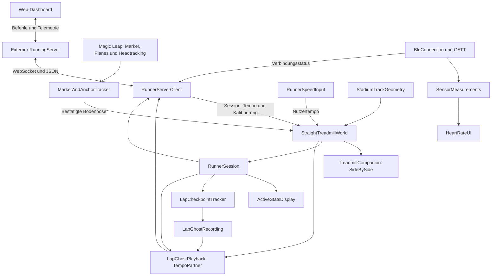

# MarkerML2 – AR-Lauftraining auf der Magic Leap 2

Stand: 28.10.2026.

MarkerML2 platziert eine virtuelle Laufbahn und einen animierten Laufpartner in der realen Umgebung. Ein AprilTag auf dem Boden und eine erkannte Bodenfläche bestimmen Position, Höhe und Ausrichtung. Die Bedienung erfolgt hauptsächlich über das Web-Dashboard des separaten RunningServer. In der Brille zeigt ein HUD Zeit, Distanz, Pace und Checkpoints.

## 1. RunningServer herunterladen und starten

Benötigt werden **Git, Node.js ab Version 22 und npm**. Alle folgenden Befehle werden im Terminal auf dem Rechner ausgeführt.

### Beim ersten Mal herunterladen

Der RunningServer ist ein eigenes Repository: [kaanguen/RunningServer](https://github.com/kaanguen/RunningServer).

```bash
cd ~
git clone https://github.com/kaanguen/RunningServer.git
cd RunningServer
npm install
npm start
```

Falls GitHub eine Anmeldung verlangt, ein Konto mit Zugriff auf das Repository verwenden.


### Server ohne Aktualisierung starten

```bash
cd ~/RunningServer
npm start
```

Danach das Dashboard unter [http://localhost:8081/](http://localhost:8081/) öffnen. Das Terminal während des Betriebs offen lassen. **Ctrl+C** beendet den Server.

### Magic Leap per USB verbinden

Die Brille per USB anschließen, USB-Debugging freigeben und im Terminal ausführen:

```bash
adb devices
adb reverse tcp:8081 tcp:8081
```

Für USB in der Serverkonfiguration `ws://127.0.0.1:8081/ws` eintragen und danach MarkerML2 auf der Brille öffnen. Die Portweiterleitung verbindet diese Adresse auf der Brille mit dem Server auf dem Rechner. Nach einem Geräte-Neustart die Weiterleitung erneut einrichten.

Für WLAN die erreichbare LAN-Adresse des Rechners in `Assets/Resources/RunnerServer.json` hinterlegen und die App neu bauen. Alternativ kann eine `runner-server.json` im geräteseitigen `Application.persistentDataPath` die Adresse überschreiben. Details stehen in [Docs/RunningServer.md](Docs/RunningServer.md).

### Lauftraining beginnen

1. RunningServer starten und Dashboard öffnen.
2. Brille verbinden und MarkerML2 starten.
3. Marker-Tracking und Spatial Mapping erlauben.
4. Den konfigurierten AprilTag aus `Dictionary_36H11` mit 10 cm Kantenlänge auf den Boden legen und zusammen mit der umgebenden Bodenfläche erfassen.
5. Nach bestätigter Platzierung erscheinen Bahn und Avatar automatisch. Der Lauf bleibt zunächst gestoppt.
6. Im Dashboard Avatar-Modus, Zielpace und Nutzer-Geschwindigkeitsquelle konfigurieren und den Lauf ausdrücklich starten.

Die Laufumgebung und der Avatar-Modus sind unabhängig:

- **Laufband:** Die virtuelle Welt bewegt sich entsprechend dem Nutzertempo, während der Nutzer ungefähr am selben realen Ort bleibt.
- **Stadion:** Die virtuelle Bahn bleibt fest; das Headtracking liefert den Nutzerfortschritt.
- **SideBySide:** Der Begleiter bleibt auf Höhe des Nutzers beziehungsweise an einer gewählten relativen Position.
- **TempoPartner:** Ein Ghost läuft mit eigener Zielpace, einem Bestzeitprofil oder einem separaten Testtempo.

Die echte Laufbandgeschwindigkeits-Anbindung ist noch nicht implementiert. Zum Testen kann eine feste Nutzer-Geschwindigkeit gewählt werden. Das Projekt enthält außerdem ein eigenes BLE-Paket für Herzfrequenz und weitere Sensordaten.

Unity-C#-Änderungen benötigen einen neuen App-Build auf der Brille. Ein Update des RunningServer aktualisiert die installierte Unity-App nicht.

## 2. Technische Grundlage

| Bereich | Im Projekt verwendete Grundlage |
| --- | --- |
| Unity | 2022.3.62f3 laut `ProjectSettings/ProjectVersion.txt` |
| Zielgerät | Magic Leap 2, Android |
| Rendering | Universal Render Pipeline, Paket 14.0.12 |
| XR | OpenXR 1.14.3, Magic-Leap-SDK, ARFoundation-Typen für Planes und XR Interaction Toolkit für Interaktion |
| Handtracking | XR Hands 1.4.3, Input Actions, XR-Ray und Pinch |
| Oberfläche | uGUI/Canvas und TextMeshPro 3.0.7 |
| Netzwerk | `ClientWebSocket`, JSON über Newtonsoft.Json |
| BLE | Eigenes Embedded Package `com.kaan.ble-sensors` mit Velorexe-Plugin und Android-JAR |

Die direkten Paketabhängigkeiten stehen in [Packages/manifest.json](Packages/manifest.json), die aufgelösten Abhängigkeiten in `Packages/packages-lock.json`. Das Magic-Leap-SDK ist über einen lokalen Dateipfad eingebunden. Dieser muss auf einem anderen Rechner angepasst werden.

## 3. Projektstruktur

```text
MarkerML2/
├── Assets/
│   ├── Scripts/
│   │   ├── MarkerAndAnchorTracker.cs   Marker, Planes und AR-Platzierung
│   │   ├── Gestures.cs                Hand-Ray und Pinch-Bedienung
│   │   ├── UIScript.cs                UI des älteren Marker-Läufers
│   │   └── StadionTracking/           Laufwelt, Geometrie, Ghost, HUD, Server
│   ├── Editor/                        Szenenaufbau, Prüfungen, Build-Werkzeug
│   ├── Scenes/                        Lauf-, Menü- und Beispielszenen
│   ├── Resources/RunnerServer.json    Serveradresse im Build
│   ├── HeartRateBLE/                  Sensor-Canvas und Profil-Assets
│   ├── Models/, Anim/, Materials/     Darstellung und Animation
│   ├── UI/                            UI-Dokumentation und Gestaltung
│   └── Samples/, TextMesh Pro/        Importierte Beispiele und Ressourcen
├── Packages/
│   ├── manifest.json                 Paketabhängigkeiten
│   └── com.kaan.ble-sensors/          Eigenständiges BLE-Paket
├── ProjectSettings/                  Unity-, Android-, XR- und Build-Einstellungen
├── Tests/StadionTracking/             Eigenständige C#-Logikprüfungen
├── Tools/generate_simple_track.py     Kartengrafik erzeugen
├── Docs/RunningServer.md              Netzwerkprotokoll und Dashboard-Bedienung
├── BLE-Delivery/                      Paketarchiv und Migrationsunterlagen
├── Build/                            Erzeugte Android-Builds
└── README.md                         Ausführliche Bedienungsanleitung
```

`Library`, `Logs`, generierte `.csproj`-Dateien und die `.sln` sind Arbeits-/Cache- beziehungsweise IDE-Dateien. Die fachliche Implementierung liegt vor allem in `Assets/Scripts` und im BLE-Paket.

Der externe Server liegt laut bestehender Projektdokumentation unter `/Users/kaan/RunningServer/`. Er ist ein separates Projekt; seine Implementierung wird in dieser Datei nicht als Bestandteil des Unity-Quellcodes inventarisiert.

## 4. Architektur und Datenfluss



Die Architektur ist komponentenbasiert. Unity-`MonoBehaviour`-Komponenten verbinden Szene, Gerätefunktionen und Darstellung. Reine C#-Klassen übernehmen Geometrie, Geschwindigkeitswahl, Checkpoints und Ghost-Daten, sodass sich diese Logik auch ohne laufende Unity-Szene prüfen lässt.

`StraightTreadmillWorld` ist die zentrale Laufwelt-Komponente. `RunnerServerClient` verbindet die Fernsteuerung mit dieser Welt. `RunnerSession` besitzt unabhängig vom HUD die Session-Uhr, Checkpoint-Auswertung und Ghost-Synchronisation. `ActiveStatsDisplay` zeigt diese Daten an; auch bei deaktiviertem HUD läuft die Session weiter. Die Quellen registrieren sich direkt statt pro Frame in der Szene gesucht zu werden.

### 4.1 Ablauf beim Start

1. Die aktive Build-Szene `Assets/Scenes/TreadmillStraightTest.unity` wird geladen.
2. `RunnerServerClient` installiert sich über die Laufzeit-/Szeneninitialisierung in einer passenden Laufszene und sucht seine Komponenten.
3. Die Session bleibt zunächst gestoppt beziehungsweise pausiert. Der Client bindet den Marker-Tracker an die gemeinsame Laufwelt.
4. Marker und Bodenfläche werden erfasst. Ein stabiler Scan, eine passende getrackte Floor-Plane samt Polygon und gültiges Headtracking sind erforderlich.
5. Der Tracker übergibt die bestätigte Bodenpose an `PlaceFromMarkerPlane(...)`.
6. Laufbahn und Avatar erscheinen automatisch; der Avatar startet auf Bahn 3. Dieser Spawn ist auch ohne Serververbindung möglich.
7. Das Dashboard konfiguriert Modus und Pace und startet den Lauf ausdrücklich.
8. Pro Frame werden Weltbewegung beziehungsweise physischer Fortschritt ausgewertet. HUD, Checkpoints und Avatar werden aktualisiert; Telemetrie geht ungefähr mit 5 Hz an den Server.

### 4.2 AR-Platzierung

Der normale Ablauf verwendet einen AprilTag aus `Dictionary_36H11` mit konfigurierter Kantenlänge 0,1 m. Der Scan benötigt mindestens drei Messungen. Eine bereits erfasste Markerbeobachtung kann verwendet werden, wenn die Plane-Erkennung erst später ein gültiges Ergebnis liefert.

Bei einer kleinen Höhendifferenz kann die Markerposition auf den Boden projiziert werden. Bei fehlerhafter Marker-Tiefe kann stattdessen der Sichtstrahl von der beim Scan gespeicherten Kameraposition zur Markerpose mit einer geeigneten Floor-Plane geschnitten werden. Polygon, Richtung und Entfernung werden geprüft.

Nach bestätigter Platzierung wird die Welt nicht ständig an neue Markerposen angehängt. Ein erneuter Scan erfolgt ausdrücklich über `scene.rescanMarker`. Dabei pausiert der Lauf, Bahn und Avatar werden vorübergehend ausgeblendet, und die bestehende Zeit/Distanz bleibt erhalten. Die Platzierung wird nicht dauerhaft über App-Neustarts gespeichert.

### 4.3 Nutzerbewegung und Avatarbewegung

Im Laufbandmodus integriert die Welt die Nutzergeschwindigkeit über die Zeit. Dabei bewegt sie die virtuelle Szenerie und lässt das physisch getrackte XR-Rig unverändert. Das Standardoval kann durch eine ältere Variante mit wiederholten geraden Kacheln ersetzt werden.

Im Stadionmodus wird die Kopfposition in lokale Bahnkoordinaten umgerechnet und auf die Bahn-1-Referenz projiziert. Rückwärtsbewegung erzeugt keine zusätzliche Vorwärtsdistanz; große Tracking-Sprünge über 5 m pro Update werden verworfen.

**Nutzertempo und Ghost-Tempo sind getrennt.** `FixedTest` liefert feste Nutzer-km/h; `Treadmill` erwartet zeitgestempelte Sensormesswerte. Fehlende, ungültige oder mehr als zwei Sekunden alte Laufbandwerte liefern 0 km/h. Der Tempo-Partner kann während einer gestarteten Session trotzdem weiterlaufen. Bei expliziter Pause frieren Uhr und Ghost ein.

### 4.4 Geometrie und Kalibrierung

Das Oval verwendet zwei 84,39-m-Geraden, 36,50 m Innenradius, acht Bahnen und 1,22 m Bahnbreite. Die Messlinie von Bahn 1 liegt 0,30 m vom Innenrand entfernt. Ihre geometrische Länge beträgt ungefähr 400,0012 m; die Laufstatistik verwendet eine 400-m-Referenz.

`EvaluateAlignedLane(...)` bildet dieselbe Referenzposition auf verschiedene Bahnen ab. Außenbahnen sind länger; `LaneSpeedScale(...)` berücksichtigt die abweichende Bewegung in den Kurven.

Für eine reale Stadionbahn können zwei Punkte A/B mit bekannter Strecke entlang der Bahn aufgenommen werden. Daraus werden Verschiebung und Drehung des Standardovals bestimmt. Das Modell wird dabei nicht skaliert. Feinversätze verschieben oder drehen die gesamte Laufwelt relativ zur Grundkalibrierung.

## 5. Projekt-Skripte und ihre Funktionen

Die folgenden Tabellen decken alle eigenen C#-Skripte unter `Assets/Scripts` ab. Aufgeführt sind die Aufgaben und die wesentlichen Einstiegspunkte; interne Formatierungs-, Aufräum- und Hilfsmethoden werden zusammengefasst.

### 5.1 Tracking und Eingabe – `Assets/Scripts/`

| Skript | Aufgabe und wichtige Funktionen |
| --- | --- |
| `MarkerAndAnchorTracker.cs` | Initialisiert Magic-Leap-Markererkennung und Plane-Erkennung, verwaltet Markerzustände und geglättete Bodenflächen. `BindRunningWorld(...)` bindet die gemeinsame Laufwelt; `UpdateRunningTrackPlacement()` prüft deren Platzierung; `FindFloorAlongMarkerRay(...)` sucht einen Bodenstrahlschnitt. Enthält außerdem den älteren separaten Marker-Avatar-Ablauf, Plane-Auswahl, Polygonprüfung und Diagnoselogs. |
| `Gestures.cs` | Verbindet Input Actions `Aim`, `PinchValue` und `PinchReady` mit einem XR-Ray-Interactor. `SetupInteractor()` richtet Zeiger und Pinch-Button mit Schwelle 0,7 ein; `Update()` übernimmt die Handpose; `UpdateSliderDrag()` bedient Slider. Fordert auf Android Handtracking-Berechtigung an und räumt erzeugte Actions auf. |
| `UIScript.cs` | Oberfläche für den `StadiumTrackPreview`-Läufer: `BindRunner(...)`, Slider, manuelle Geschwindigkeit/Zielrundenzeit, Animationsanbindung, Statistik und Kartenanbindung. Richtet bei Bedarf das XR-UI-Inputmodul ein. Dieser Pfad ist vom aktuellen Dashboard-gesteuerten Weltablauf zu unterscheiden. |

### 5.2 Laufwelt und Konfiguration – `Assets/Scripts/StadionTracking/`

| Skript | Aufgabe und wichtige Funktionen |
| --- | --- |
| `StraightTreadmillWorld.cs` | Zentrale Laufwelt: Platzierung, Distanz, virtuelle Weltbewegung, feste Stadionwelt und Kalibrierung. `BeginMarkerPlacement()`/`PlaceFromMarkerPlane(...)` steuern den Bodenbezug; `AdvanceSimulation(...)` die Simulation; `UpdatePhysicalProgress(...)` den Headtracking-Fortschritt. `SetTrackEnvironment(...)`, `SetAvatarLane(...)`, `CaptureTrackPointA/B(...)` und `SetCalibrationOffsets(...)` konfigurieren die Welt. `ConfigureUserSpeed(...)`, `ReportTreadmillSpeedKmh(...)` und `ClearTreadmillSignal()` bilden die Geschwindigkeits-API. `GetLanePoseAtDistance(...)` liefert Avatarposen; `ResetDistance()` setzt den Laufbezug zurück. Enthält zusätzlich ältere Höhenkalibrierungswege. |
| `RunnerSpeedInput.cs` | Reine C#-Logik zur Wahl von `FixedTest` oder `Treadmill`. `SelectSource(...)` wechselt die Quelle, `ReportTreadmill(...)` nimmt gültige Messwerte mit Zeitstempel an, `HasFreshTreadmill(...)` prüft die Signalfrische, `SpeedKmh(...)` liefert das verwendbare Tempo. `InvalidateTreadmill()` löscht die Signalverfügbarkeit. |
| `RunnerSessionSettings.cs` | Statische Einstellungen innerhalb des laufenden Prozesses: Pace in Sekunden/km, Körperhöhe, Avatar-Modus, Bahnsichtbarkeit und `Pending`. Ausgangswerte im Code: 360 s/km, 184 cm, `TempoPartner`, sichtbare Bahn. Kein dauerhafter Datenspeicher. |
| `RunnerSessionBootstrap.cs` | Übernimmt in `Awake()` ausstehende Menüeinstellungen in Welt und Begleiter und löscht danach `Pending`. Gehört zur Übergabe des älteren Menüablaufs. |
| `TreadmillHeightSetup.cs` | Ältere Höhen-/Bodeneinrichtung mit Menü, Zifferneingabe, Bodenursprung und manueller Korrektur. `PrepareMenu()`, `ApplyHeight()`, `ApplyFloor()`, `Adjust(...)` und `Finish()` organisieren diesen Ablauf. Die aktuelle Marker-/Plane-Platzierung benötigt diese Körperhöheneingabe nicht. |

### 5.3 Bahnmodell und älterer Vorschau-Läufer

| Skript | Aufgabe und wichtige Funktionen |
| --- | --- |
| `StadiumTrackGeometry.cs` | Reines Bahnmodell. `Radius(...)` und `Length(...)` liefern Bahndimensionen; `Evaluate(...)` Position und Tangente nach geometrischer Strecke; `EvaluateAlignedLane(...)` nebeneinander ausgerichtete Bahnen; `LaneSpeedScale(...)` die Geschwindigkeitskorrektur; `Project(...)` die nächste Streckenposition; `DetectLane(...)` die Bahnnummer. |
| `StadiumCalibration.cs` | Mathematische Hilfen: `SolveYaw(...)` bestimmt die Ausrichtung zwischen Modell- und Weltbasis; `WrappedDelta(...)` behandelt den Übergang zwischen Rundenende und Rundenanfang. |
| `FloorMarkerPlacement.cs` | Unity-unabhängige Platzierungslogik: `CanUseScan(...)` bewertet Scan-Reife/-Zeitpunkt, `TryProject(...)` projiziert auf eine Ebene, `TryIntersectFloor(...)` prüft und berechnet einen Bodenstrahlschnitt. Die Zuordnung zum konkreten Plane-Polygon bleibt Aufgabe des Trackers. |
| `StadiumRunProgress.cs` | Einfacher Distanz-/Rundenzähler für den Vorschau-Läufer. `Advance(...)` integriert Geschwindigkeit und Zeit; `CompletedLaps` liefert abgeschlossene Runden. |
| `StadiumPacing.cs` | Definiert `ManualSpeed` und `TargetLapTime`. `SpeedForLapTime(...)` rechnet Bahnlänge und Zielrundenzeit in Geschwindigkeit um. |
| `StadiumPreviewSettings.cs` | Serialisierbare Einstellungen und `StadiumAnchorMode` für den markerbasierten Vorschau-Läufer, einschließlich seiner Strecken-/Darstellungsparameter. |
| `StadiumTrackPreview.cs` | Eigenständiger Avatar-Läufer für den älteren Marker-/Vorschaupfad. `Initialize(...)` setzt Bezug und Bahn; `AlignAvatar(...)` richtet das Modell aus; `AdvanceRun(...)` aktualisiert Fortschritt; `GetRunningPose(...)` liefert die Pose. Unterstützt Slidergeschwindigkeit, Zielrundenzeit, Animationskalibrierung und gezeichnete Routen. |
| `SimpleTrackMap.cs` | Definiert Kartenmaße und wandelt mit `ToUv(...)` lokale X/Z-Bahnkoordinaten in Karten-UVs um. |
| `RunnerMapMarker.cs` | Bindet mit `BindRunner(...)` einen Vorschau-Läufer an die Minikarte. Aktualisiert in `LateUpdate()` den Punkt; die zusätzliche Klasse `RunnerMapDot` zeichnet dessen UI-Mesh. |

### 5.4 Avatar, Ghost und Rekorde

| Skript | Aufgabe und wichtige Funktionen |
| --- | --- |
| `TreadmillCompanion.cs` | Stellt den SideBySide-Begleiter dar und definiert `TreadmillRunMode`. `ConfigurePlacement(...)` setzt Richtung, Abstand und Blickrichtung; `UseLanePlacement()` aktiviert die Bahnauswahl; `SetMode(...)` wählt den Modus; `Synchronize()` erzeugt/positioniert/animiert den Begleiter. Im TempoPartner-Modus wird dieser Avatar ausgeblendet, weil dort die Ghost-Wiedergabe zuständig ist. |
| `LocomotionTiming.cs` | `Evaluate(...)` berechnet aus Geschwindigkeit und kalibrierten Geh-/Laufgeschwindigkeiten die Animationsmischung und zeitliche Wiedergabe. Verbindet Distanztempo und sichtbare Gangart. |
| `AvatarLocomotion.cs` | Gemeinsame Erkennung der Animator-Parameter, Kalibrierung der Gangarten und Anwendung der Animationswerte für Begleiter, Ghost und Vorschau. Die Aufrufer bestimmen weiterhin selbst, ob die Animation bei Pause einfriert oder in Idle übergeht. |
| `AvatarGrounding.cs` | Gemeinsame Messung des tiefsten Skinned-Mesh-Punkts und des Sohlenversatzes. Der Marker-Läufer behält seinen eigenen Fallback für statische Meshes. |
| `LapCheckpointTracker.cs` | Wertet mit `Update(distance, elapsed)` 100-m-Checkpoints, Runden und Kilometer aus. Interpoliert Grenzübertritte zwischen Updates, verwaltet Vergleichszeiten und tatsächlich gemessene Rekorde und versorgt `GhostRecording`. Ziel-/Beispielwerte sind von gemessenen Rekorden getrennt. |
| `LapGhostRecording.cs` | Speichert Zeit-/Distanzpunkte einer vollständigen Runde und übernimmt ein geeignetes neues Bestprofil. `Begin(...)`, `Record(...)`, `Finish(...)` werden vom Tracker genutzt; normale Samples sind auf ungefähr 10 Hz begrenzt. `Evaluate(...)` interpoliert innerhalb einer Runde, `EvaluateContinuous(...)` spielt Runden fortlaufend ab. Bestprofil und Ghost-Samples werden zusätzlich durch `RunnerRecordsStore` dauerhaft gespeichert. |
| `LapGhostPlayback.cs` | Erzeugt und animiert den TempoPartner-Avatar. `Synchronize(...)` verbindet Session-Uhr, Bestprofil und Weltpose; `SetTestSpeed(...)` aktiviert/deaktiviert das separate Ghost-Testtempo; `ResetTestPosition()` setzt dessen Fortschritt zurück. Misst den Sohlenversatz und räumt erzeugte Avatarobjekte auf. |
| `GhostTestMotion.cs` | Reiner Testtempo-Integrator. `SetSpeed(...)` übernimmt ein optionales Tempo und die aktuelle Distanz; `Advance(...)` bewegt nur bei laufender Session; `Reset()` setzt die Distanz zurück. |
| `RunnerSession.cs` | Eigenes Szenenobjekt für Session-Uhr, Checkpoints, Rekorde und Ghost. Verarbeitet direkt gebundene Laufquellen unabhängig von HUD und Kamera; Pause, Reset und Quellenwechsel werden hier ausgewertet. |
| `RunnerRecordsStore.cs`, `RunnerPersonalBest.cs` | Gespeicherte persönliche Bestleistungen und Ghost-Samples laden, validieren und ausschließlich durch bessere Werte ersetzen. |
| `RunnerRecordPersistence.cs` | Gemeinsame Hintergrundwarteschlange für Dateizugriffe mit automatischer Wiederholung fehlgeschlagener Schreibaufträge. Ausstehende Daten bleiben bei Sessionwechseln erhalten. |
| `RunnerSessionState.cs` | Typisierte Session-/Trackingzustände und lesbare Trackingmeldungen. Das Serverprotokoll behält die bisherigen Zustandstexte. |
| `ActiveStatsDisplay.cs` | Formatiert Pace, Zeit und Checkpointvergleich aus der Session. Die bisherigen Methoden `ResetSessionStats()`, `RefreshTargetPace()` und `BindRunner(...)` delegieren zur unabhängigen Session. |

Ein vollständiger 100-m-/400-m-/1-km-Abschnitt ist für einen gemessenen Rekord erforderlich. Die erste vollständige Runde wird zum Ghost-Profil, auch wenn sie langsamer als die Zielpace ist. Ohne vollständige Aufnahme verwendet der Ghost die Zielpace. Pace-, Modus- und Sichtbarkeitsänderungen erhalten Zeit, Distanz, Rekorde und Ghost-Aufnahme und pausieren den Lauf. Explizites Zurücksetzen, Umgebungswechsel und App-Neustart beginnen einen neuen Lauf; gespeicherte persönliche Bestleistungen bleiben erhalten und werden für die passende Umgebung geladen.

### 5.5 Oberfläche und lokale Navigation

| Skript | Aufgabe und wichtige Funktionen |
| --- | --- |
| `RunnerArPanel.cs` | Registriert aktive AR-Panels und positioniert sie relativ zur Kamera und zum vorgesehenen Sichtbereich. Unterscheidet Hauptmenü und Lauf-HUD. |
| `RunnerGlassGraphic.cs` | Eigene uGUI-`MaskableGraphic`, die über `OnPopulateMesh(...)` die Panel-Fläche zeichnet. `FlatSurface` verändert die Darstellungsvariante. |
| `RunnerUiTheme.cs` | Gemeinsame Farben, Schrift und UI-Erzeugung. `StyleText(...)`, `Panel(...)`, `Rect(...)`, `Text(...)`, `Button(...)` und `Rule(...)` erstellen beziehungsweise gestalten Canvas-Elemente. Lädt die Schrift aus `Resources/RunnerUI/RunnerSans`. |
| `RunnerMainMenu.cs` | Älteres lokales Startmenü. `ChangePace(...)`, `ChangeHeight(...)`, `SetMode(...)`, `ToggleTrackVisibility()` bearbeiten Session-Einstellungen; `Refresh()` aktualisiert Texte; `StartSession()` startet den Szenenübergang. |
| `RunnerSessionNavigation.cs` | Ältere lokale Pause-/Menünavigation. `TogglePause()` pausiert/reaktiviert die Welt und speichert dazu das Tempo; `BackToMenu()` lädt `RunnerMainMenu`. Diese Szene ist aktuell nicht in der aktiven Build-Szenenliste enthalten. |

### 5.6 Netzwerk

Die Aufteilung des Codes und die erhaltenen Kompatibilitätspfade sind in [Docs/CodeStructure.md](Docs/CodeStructure.md) beschrieben.

| Skript | Aufgabe und wichtige Funktionen |
| --- | --- |
| `RunnerServerClient.cs` | Initialisiert die Unity-Serverbrücke und verarbeitet Verbindungsereignisse auf dem Hauptthread. Zeigt zuerst den Adressdialog; pausiert bei Trennung. Die Teilklassen `RunnerServerClient.Commands.cs` und `RunnerServerClient.Telemetry.cs` enthalten Befehle/ACKs und die Telemetrie. |
| `RunnerServerConnection.cs` | WebSocket-Aufbau mit festem Handshake-Timeout, Retry, typisierte Statusereignisse, konkrete Fehlerdiagnose und Abbruch. Jede Verbindung besitzt eigene Queues, damit ein Adresswechsel keine Nachrichten alter Verbindungsversuche übernimmt. |
| `RunnerServerConfiguration.cs` | Lädt die gebündelte Adresse und das Geräte-Override, normalisiert IP-/WebSocket-Adressen und speichert die Eingabe. |
| `RunnerServerSetup.cs` | Startdialog mit Adressfeld, Zahlenfeld und Verbinden-Button; bleibt bei Fehlern zur Korrektur offen. |
| `RunnerCommandValues.cs` | Unity-unabhängige Validierung numerischer und boolescher Befehlswerte mit Typ- und Bereichsprüfung. |

## 6. Serversteuerung und Zustände

Die eingebaute WLAN-Adresse steht in `Assets/Resources/RunnerServer.json`: aktuell `ws://192.168.178.120:8081/ws`. Eine Datei `runner-server.json` in `Application.persistentDataPath` kann sie überschreiben. Für USB dort `ws://127.0.0.1:8081/ws` verwenden; `adb reverse tcp:8081 tcp:8081` verbindet diese Brillenadresse mit dem Server auf dem Rechner. Bei einem Wechsel der WLAN-IP muss die Konfiguration angepasst werden.

Nach dem Verbindungsaufbau sendet Unity `hello` mit Rolle `headset` und anschließend eine `registry` mit unterstützten Befehlen. Das Dashboard darf nur auf tatsächlich gemeldete Fähigkeiten vertrauen.

| Befehlsgruppe | Funktion |
| --- | --- |
| `runningMate.configure` | Pace, Modus und Bahnsichtbarkeit konfigurieren; Statistik/Aufnahme erhalten und pausieren |
| `runningMate.command` | `spawn`, `start`, `pause`, `resume`, `stop`, `reset`, `despawn` |
| `runningMate.setLane` | Avatar-Bahn 1–8 auswählen |
| `runningMate.setUserSpeed` | Feste Nutzer-km/h oder Laufbandquelle wählen |
| `runningMate.setGhostSpeed` | Separates Ghost-Testtempo; `null` aktiviert normale Wiedergabe |
| `scene.setTrackEnvironment` | Laufband oder feste Stadionwelt auswählen |
| `scene.rescanMarker` | Neue Marker-/Bodenplatzierung anfordern |
| `scene.captureTrackPoint` | Stadionreferenz A/B erfassen |
| `runningMate.adjust` | Absolute Feinverschiebung/Drehung oder Rücksetzen der Feinversätze |
| `avatar.configurePlacement`, `avatar.reposition` | Relative SideBySide-Platzierung beziehungsweise Rückkehr zum Markeranker auf der Boden-Plane |
| `scene.setRunningMatePathVisible` | Bahn ein-/ausblenden |
| `scene.setRunningMateHudVisible`, `scene.setHudVisible` | HUD ein-/ausblenden |
| `sensor.connect`, `sensor.disconnect` | Vorhandene BLE-Verbindung bedienen; kein neuer Scan durch diese Befehle |

Kompatibilitätswege für Körperhöhe und manuelle Höhenkorrektur bleiben im Code, gehören aber nicht zum aktuellen Dashboard-Ablauf. Die genaue Payload-Struktur steht in [Docs/RunningServer.md](Docs/RunningServer.md).

Der Client meldet `Stopped`, `Ready`, `Running` oder `Paused`. Sichtbarer Avatar und laufende Session sind getrennte Zustände. `start`/`spawn` setzen Bahn 3, `resume` erhält die später gewählte Bahn. Ein Verbindungsabbruch pausiert; ein Wiederverbinden startet nicht automatisch weiter.

Telemetrie enthält Nutzerdistanz, Zeit, Tempo, Runden, Umgebung, gewählte Quelle, Marker-/Kalibrierungsstatus, Trackingzustand, Avatar-Bahn, Ghost-Daten und Rekorde. `recordsStatus` enthält gegebenenfalls einen Lade-/Speicherfehler. Die Laufdaten stehen unter `data.treadmill` sowie kompatibel unter `data.runningMate`; hinzu kommen BLE-Verbindungsstatus und HUD-Sichtbarkeit.

## 7. BLE-Sensorarchitektur und Skripte

Das eigene Embedded Package liegt unter `Packages/com.kaan.ble-sensors`. Es besitzt getrennte Runtime-/Editor-Assemblies. Die Szene behält ihre eigenen XR-Eingaben; das Paket installiert kein XR-Rig.

```text
HeartRateUI → BleConnection → Velorexe / AndroidBleGattBackend
                    ↓                    ↓
             BleDeviceProfile       BleGattQueue
                    └──────────┬─────────┘
                         Empfangene Bytes
                               ↓
                       SensorMeasurements
                               ↓
                 HeartRateParser / CosinussParsers
                               ↓
                     Messwertanzeige / Events
```

| Skript unter `Runtime/` | Aufgabe und wichtige Funktionen |
| --- | --- |
| `BleConnection.cs` | Allgemeine Gerätesuche, Auswahl, Verbindung und Ereignisse. `StartScan()`, `StopScan()`, `SelectDevice(...)`, `Connect()`, `Disconnect()` bedienen den Lebenszyklus. `Read(...)`, `Subscribe(...)`, `HasCharacteristic(...)` bilden GATT-Zugriffe ab. Verwaltet Gerätekandidaten, Laufzeitberechtigungen und Aufräumen. |
| `BleDeviceProfile.cs` | `BleDeviceProfile` definiert Filter und Kanäle als ScriptableObject. `Matches(...)` prüft Geräte, `Validate()` die Konfiguration. `BleChannel` beschreibt Service/Characteristic, Datenformat und Update-Modus; `BleUuid.Normalize(...)`/`Key(...)` vereinheitlichen UUIDs. |
| `BleGattQueue.cs` | Serialisiert GATT-Aufträge. `Enqueue(...)` legt Aufträge ab, `Tick(...)` bearbeitet Ablauf/Timeouts, `Handle(...)` ordnet native Antworten zu. Meldet Abschluss/Fehler und räumt mit `Clear()`/`Dispose()` auf. |
| `AndroidBleGattBackend.cs` | Implementiert `IBleGattBackend` über JNI und das native Companion-JAR; stellt Characteristic-Eigenschaften, Lesen und Abonnieren bereit. |
| `SensorMeasurements.cs` | Abonniert BLE-Ereignisse und dekodiert Profilkanäle. Verwaltet Messwerte und deren Anzeigezustand; berücksichtigt verschiedene Sauerstoff-Datenformate. |
| `HeartRateParser.cs` | `ParseMeasurement(...)` liest standardisierte Herzfrequenzpakete einschließlich Flags und RR-Intervallen; `Parse(...)` liefert nur BPM. |
| `CosinussParsers.cs` | Dekodiert Temperatur, Pulsoximetrie, Batterie und Sensorstatus. Enthält IEEE-11073-/Half-Float-Konvertierungen und Fehlerbeschreibungen. |
| `CosinussProfileDefaults.cs` | `Create(...)` erstellt ein Standardprofil für cosinuss-Kanäle, optional mit übergebenen Herzfrequenz-UUIDs. |
| `HeartRateUI.cs` | Verknüpft Scan-/Stop-/Connect-/Disconnect-Buttons, Geräte-Dropdown sowie Status- und Messwerttexte mit Verbindung und Messwertkomponente. |
| `HeartRateBLE.cs` | Kompatibilitätsklasse auf Basis von `BleConnection`; erstellt bei fehlendem Profil über `CreateFallbackProfile()` die cosinuss-Standardkonfiguration. |
| `CosinussMeasurements.cs` | Kompatibilitätsklasse, die von `SensorMeasurements` erbt. |

`Editor/BleProfileMenu.cs` stellt den Menüpunkt **Assets → Create → BLE → Cosinuss-Standardprofil** bereit. `Runtime/Plugins/Android/cosinuss-gatt.jar` enthält die native Companion-Brücke. Das Android-Manifest und seine BLE-Berechtigungen sind für den Gerätebetrieb erforderlich.

Das Paket kann Sensordaten lokal auswerten. Die RunningServer-Brücke überträgt den BLE-Verbindungsstatus und frische, gültige SpO₂-Werte. Unter **Laufband → Sammelkugeln** steuert wahlweise der Sauerstoffsensor die Kugelmenge oder eine feste Eingabe von 0–30 Kugeln pro Reihe ohne Sensor. Sensorwahl öffnet den bestehenden Sensor-Dialog auf der Brille; dort scannen und verbinden. Höhere SpO₂-Werte erzeugen mehr Kugeln; ohne gültige Daten pausiert die Kugelerzeugung im Sensormodus. Details zur Spielzuordnung und zum Protokoll stehen in [Docs/RunningServer.md](Docs/RunningServer.md#schwebende-sammelkugeln-und-sauerstoffsensor). **Die BLE-Sensoranbindung ist keine fertige Laufbandgeschwindigkeits-Anbindung.** Ein zukünftiger Adapter muss `ReportTreadmillSpeedKmh(...)` auf dem Unity-Hauptthread aufrufen und bei Signalverlust `ClearTreadmillSignal()` melden.

Details und Einschränkungen stehen in [Packages/com.kaan.ble-sensors/README.md](Packages/com.kaan.ble-sensors/README.md).

## 8. Editor-Werkzeuge

Diese Dateien liegen unter `Assets/Editor` und gehören zu Einrichtung, Entwicklung und Prüfung, nicht zum Laufzeitablauf auf der Brille.

| Skript | Funktion |
| --- | --- |
| `StraightTreadmillSetup.cs` | `CreateScene()` erstellt die gerade Testszene; weitere Menüpunkte ergänzen den älteren Höhenaufbau oder prüfen Bewegung, automatische Platzierung und Höhenmenü. |
| `TreadmillOvalSetup.cs` | `ConfigureScene()` richtet die 400-m-Ovaldarstellung ein; `CreateMesh()` erzeugt ihre Geometrie; `VerifyMotion()` prüft die Weltbewegung. |
| `TreadmillCompanionSetup.cs` | `ConfigureScene()` ergänzt den Begleiter; `Verify()` prüft ihn im Play Mode. |
| `RunnerUiGuideSetup.cs` | `ApplyAll()` erzeugt/stylt UI-Assets, Canvases und das Hauptmenü; `AddTrackVisibilityOption()` ergänzt die Sichtbarkeitsoption. |
| `TreadmillDeviceBuild.cs` | `Build()` baut die Laufszene als Android-Development-APK nach `Build/TreadmillMenuFix.apk`. Schreibt das Ergebnis nach `Temp/TreadmillPreviews/device-build-result.txt`. Menü: **Tools → Treadmill → Build device verification APK**. |
| `LapCheckpointTrackerChecks.cs` | Prüft Checkpoints und Bestzeiten über einen Unity-Menüpunkt. |
| `LapGhostChecks.cs` | Prüft Ghost-Aufnahme, Avatar und Positionsabgleich. |
| `TreadmillRunModeChecks.cs` | Prüft beide Avatar-Modi im Play Mode. |
| `RunnerUiChecks.cs` | Prüft beziehungsweise zeigt Menü, Sessionstart, Bahn, Pause, Sensor-UI und Läufersteuerung. Enthält auch Vorschau-/Szenenaktionen. |

Einige Werkzeuge erwarten ältere Menü-/Höhenabläufe. Setup-Menüpunkte können Szenen und Assets verändern und sollten gezielt verwendet werden.

## 9. Szenen, Prefabs und importierte Beispiele

| Ressource | Bedeutung |
| --- | --- |
| `Assets/Scenes/TreadmillStraightTest.unity` | Aktuell einzige aktivierte Build-Szene. Trotz des historischen Namens wird sie auch für das Oval-/Marker-Lauftraining verwendet. |
| `Assets/Scenes/SampleScene.unity` | Vorhandene alternative Szene, in den Build-Einstellungen deaktiviert. |
| `Assets/Scenes/RunnerMainMenu.unity` | Älteres lokales Hauptmenü; derzeit nicht in der Build-Szenenliste. |
| `Assets/Scenes/UI.unity` | Zusätzliche UI-Szene, derzeit nicht in der Build-Szenenliste. |
| `Assets/Jogger.prefab` | Läufer-Prefab als wiederverwendbare Avatarressource. |
| `Assets/MarkerPrefab.prefab` | Ressource des Markerpfads. |
| `Assets/Materials/RunnerStatsCanvas.prefab` | Wiederverwendbare Statistik-/Steuerungsoberfläche. |
| `Assets/Materials/planeAR.prefab` | Ressource zur Darstellung erkannter Flächen. |
| `Assets/HeartRateBLE/HeartRateCanvas.prefab` | Sensoroberfläche. |
| `Assets/Anim/Controller.controller` | Animator-Ressource für die Avataranimation. |

Importierte Beispielskripte gehören zu den jeweiligen Paketen und bilden nicht die zentrale Projektarchitektur:

- **Android BLE Sample:** `ExampleBleInteractor.cs` und `DeviceRowView.cs` demonstrieren BLE-Bedienung und Geräteeinträge.
- **XR Hands HandVisualizer:** `HandVisualizer.cs` und `HandProcessor.cs` dienen der Handvisualisierung/-verarbeitung im Sample.
- **Magic Leap Sample:** `MagicLeapController.cs` gehört zum importierten Rig-/OpenXR-Beispiel.
- **TextMesh Pro Examples & Extras:** Demonstrationen für Texte, Interaktionen, Animationen und Benchmarks, etwa `TMP_TextSelector_A/B`, `VertexShakeA/B`, `WarpTextExample` und `Benchmark01–04`. Diese sind Beispielcode, keine eigene Lauftrainingslogik.

## 10. Tests und Hilfsprogramme

Die Dateien unter `Tests/StadionTracking` haben jeweils einen eigenen `Main()`-Einstiegspunkt und prüfen Unity-unabhängige Logik. Sie sind keine automatisch entdeckten Unity-Test-Runner-Tests. Alle Prüfungen lassen sich mit Python 3 und einem installierten .NET SDK ab Version 6 gemeinsam ausführen:

```bash
python3 Tools/run_logic_checks.py
```

Das Werkzeug wählt einen gemeinsamen Einstiegspunkt, kompiliert in einem temporären Verzeichnis und benötigt keine Paketdownloads. Für die Protokollprüfungen wird die vorhandene Newtonsoft.Json-DLL aus `Library/PackageCache` verwendet; das Projekt dafür zuvor einmal in Unity öffnen. Die Prüfungen ersetzen keine Play-Mode- oder Gerätetests für Animation, Mesh-Bodenabstand und XR-Platzierung.

| Datei | Prüfthema |
| --- | --- |
| `GeometryChecks.cs` | Bahnlängen, Übergänge, Projektion, Kartenbezug und Lauf-Fortschritt |
| `FloorMarkerPlacementChecks.cs` | Bodenprojektion, Strahlschnitt und zeitliche Scanverwendbarkeit |
| `StadiumCalibrationChecks.cs` | Zwei-Punkt-Ausrichtung und Rundenübergänge |
| `LocomotionChecks.cs` | Gangarten-/Animationsberechnung |
| `GhostTestMotionChecks.cs` | Separates Ghost-Testtempo, Tempoänderungen und Pause |
| `MeasuredRecordsChecks.cs` | Tatsächlich gemessene Rekorde und Abgrenzung zu Vorgaben |
| `RunnerSpeedInputChecks.cs` | Geschwindigkeitsquellen, Messwertvalidierung und Signalalter |
| `CommandValueChecks.cs` | Numerische Protokolltypen, Grenzwerte, fehlende Werte, Nullwerte und boolesche Werte |

`Tools/generate_simple_track.py` liest Konstanten aus `StadiumTrackGeometry.cs` und `SimpleTrackMap.cs` und erzeugt mit Python/Pillow `Assets/Scripts/StadionTracking/Resources/SimpleTrack.png`. Dadurch beruhen Karte und Laufbahn auf denselben Abmessungen.

## 11. Speicherung und Lebensdauer der Daten

| Daten | Ort und Lebensdauer |
| --- | --- |
| Serveradresse im Build | `Assets/Resources/RunnerServer.json` |
| Optionale Serverüberschreibung | `Application.persistentDataPath/runner-server.json` auf dem Gerät |
| Pace/Modus und Menüübergabe | Statische `RunnerSessionSettings` im laufenden Prozess |
| Zeit, Distanz und laufende Aufnahme | Laufzeitobjekte der aktuellen Session |
| Persönliche Bestzeiten und Ghost der besten Runde | Versionierte JSON-Dateien in `Application.persistentDataPath/runner-records/`, getrennt nach Umgebung; temporärer Schreibpfad und `.bak`-Sicherung |
| AR-Platzierung | Aktuelle XR-Session; kein dauerhafter räumlicher Anker über Neustarts |
| BLE-Profile | ScriptableObject-Assets im Projekt |
| Dashboard-Entwurf | Laut vorhandener Serverdokumentation lokal im Browser; getrennt von der angewendeten Unity-Konfiguration |
| Serveraufzeichnungen | Laut vorhandener Serverdokumentation `RunningServer/recordings/<ID>/` mit `ble_data.csv`, `exercise_detections.csv`, `commands.jsonl`, `session_meta.json` |

Server-Session, Serveraufnahme und Unity-Lauf sind getrennte Abläufe. Eine gestartete Serveraufnahme startet den Lauf nicht automatisch. Es gibt laut bestehender Dokumentation noch keinen eigenen Serverexport für Laufbahnpositionen oder Rekordzeiten.

## 12. Aktueller Stand und Grenzen

- Die reale Laufband-Hardwareanbindung ist vorbereitet, aber noch nicht implementiert. Ohne gültige Messwerte liefert diese Quelle 0 km/h. Die App steuert keinen Laufbandmotor.
- Die vorhandene README bezeichnet `Build/MarkerFloorFix.apk` als zuletzt erfolgreich auf dem Gerät geprüften Build. Die anschließend ergänzte Nutzer-Geschwindigkeitswahl und unabhängige Pace-Logik benötigen danach einen neuen Geräte-Build. Diese Dokumentation hat den installierten Gerätestand nicht neu geprüft.
- Eine vollständige reale 400-m-Session und echte Laufbanddaten sind laut vorhandener Dokumentation noch nicht durch einen vollständigen Geräte-Lauf verifiziert.
- Eine erkannte lokale Bodenfläche vermisst nicht automatisch das gesamte reale Stadion. Zwei Kalibrierpunkte passen ein Standardoval an, keine beliebige Bahnform.
- Ältere Menü-, Höhen- und Vorschaupfade bleiben enthalten. Für den aktuellen Ablauf sind Dashboard, Marker-/Plane-Platzierung und `StraightTreadmillWorld` maßgeblich.
- Das native BLE-JAR hängt an Details des verwendeten Velorexe-Plugins; ein Paketupdate benötigt erneute Prüfung.

## 13. Orientierung für Änderungen

| Gewünschte Änderung | Zuerst ansehen |
| --- | --- |
| Marker wird erkannt, Welt erscheint nicht | `MarkerAndAnchorTracker.cs`, `FloorMarkerPlacement.cs`, Platzierungsstatus |
| Bahnposition, Weltbewegung oder Stadionfortschritt | `StraightTreadmillWorld.cs`, `StadiumCalibration.cs` |
| Bahnform, Bahnbreiten oder Positionsberechnung | `StadiumTrackGeometry.cs`; passende Mesh-/Kartenerzeugung berücksichtigen |
| Nutzer-Testtempo oder Laufbandsignal | `RunnerSpeedInput.cs`, Geschwindigkeits-API der Welt |
| SideBySide-Position und Animation | `TreadmillCompanion.cs`, `LocomotionTiming.cs` |
| Ghost-Pace, Profilwiedergabe oder Testtempo | `LapGhostPlayback.cs`, `LapGhostRecording.cs`, `GhostTestMotion.cs` |
| Rekorde, Zwischenzeiten oder Uhr | `LapCheckpointTracker.cs`, `RunnerSession.cs` |
| Fernsteuerungsbefehl oder Telemetrie | `RunnerServerClient.cs`, `Docs/RunningServer.md`, zusätzlich separates Serverprojekt |
| HUD-Gestaltung | `RunnerUiTheme.cs`, `RunnerArPanel.cs`, `RunnerGlassGraphic.cs`, HUD-Prefab |
| Hand-Ray oder Pinch | `Gestures.cs`, Input-Action-Assets und XR-Interactor der Szene |
| BLE-Gerätefilter oder Datenkanäle | `BleDeviceProfile.cs` und das zugewiesene Profil-Asset |
| Neues Sensordatenformat | `SensorMeasurements.cs`, Parser im BLE-Paket |
| Android-Geräte-Build | Build Settings, Android-/XR-Einstellungen, `TreadmillDeviceBuild.cs` |

Weitere Anleitungen: [README.md](README.md), [RunningServer-Protokoll](Docs/RunningServer.md), [BLE-Paket](Packages/com.kaan.ble-sensors/README.md) und [UI-Styleguide](Assets/UI/STYLE_GUIDE_IMPLEMENTATION.md).

## Behaviour – Avatar-Animationen

Der eigene Tab **Behaviour** steuert die Animationen des Jogger-Avatars in MarkerML2.
Verfügbar sind die originalen Mixamo-Clips Arme & Beine aufwärmen aus Batter On Deck (17,03 s; ohne Schlägerhalten und Schlagen) und
Jumping Jacks (1,67 s pro Zyklus; Mixamo-Öffnungsbewegung mit umgekehrtem Rückweg, fortlaufend bis zum Stoppen)
Zusätzlich gibt es Warming Up · ohne Schläge (2,07 s; bis vor die Faustschläge),
Auch Arm Stretching · Arme dehnen (8,87 s) und Air Squat · Kniebeugen (1,87 s)
stehen zur Auswahl; sowie Stehen, Gehen, Joggen und Sprinten als Bewegungsvorschau am Platz.

1. Die aktualisierte MarkerML2-App auf der Brille starten und mit dem Server verbinden.
2. Unter Kalibrierung Bodenmarker und Avatar-Platzierung einrichten.
3. Behaviour öffnen, optional Wiederholung und Abspieltempo (0,25–2×) einstellen.
4. Bei einem Clip Abspielen wählen. Ein laufender Lauf wird pausiert; Distanz,
   Laufzeit und Bestzeiten bleiben erhalten. Die Animation läuft am aktuellen
   Begleiter – Side by Side oder Tempo-Partner – ohne Root Motion.
5. Zur Laufbewegung beendet die manuelle Auswahl. Der Lauf bleibt pausiert;
   im Tab Laufband mit Fortsetzen weiterlaufen.

Ohne Wiederholung endet die Auswahl nach einer Clip-Länge automatisch. Laufstart,
Fortsetzen, Stoppen, Reset und Verbindungsabbruch beenden ebenfalls die manuelle
Animation. Fehlende/alte App-Versionen und fehlende Clips werden gesperrt angezeigt.
Erfolgsmeldungen erscheinen erst nach der Bestätigung aus Unity.

Das Dashboard allein aktualisiert die Unity-App nicht. Für die Brille ist nach
Übernahme der Unity-Änderungen ein neuer Build erforderlich.

Die Unity-Seite verwendet `RunnerAvatarBehaviour`, die Resource `JoggerBehaviourLibrary`
und die Animator-States `Behaviour_*` im vorhandenen Controller. Die Asset-Einrichtung
ist über Tools > Jogger > Install RunningServer behaviour controls wiederholbar.


Plank ist im Behaviour-Tab als einzelner Ablauf verfügbar: Start Plank → 10 Sekunden Halten → End Plank. Bei Normaltempo dauert die Sequenz einschließlich Überblendungen etwa 18,34 Sekunden. Wiederholung startet danach den kompletten Ablauf neu.


Die Plank-Haltedauer lässt sich im Behaviour-Tab im Feld „Plank halten · Sekunden“ vor dem Abspielen auf 1–300 Sekunden einstellen. Standard ist 10. Bei Normaltempo entspricht die Eingabe der realen Haltezeit; Tempo 2× halbiert sie. Die Änderung gilt ab dem nächsten Abspielen. Dafür die aktualisierte Unity-App mit den drei Plank-States verwenden.
