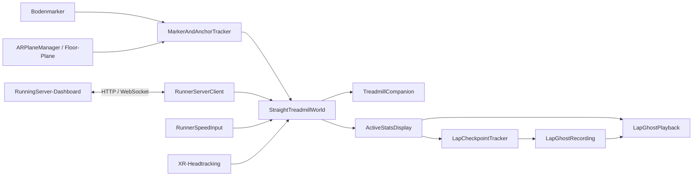

# MarkerML2 – AR-Lauftraining und RunningServer

**Stand: 27.10.2026.** Diese README beschreibt den aktuellen Quellcode. Der zuletzt auf der Magic Leap geprüfte Build enthält die Marker-/Plane-Platzierung. Die anschließend ergänzte Nutzer-Geschwindigkeitsauswahl und die vollständig unabhängige Avatar-Pace benötigen noch einen neuen Geräte-Build.

MarkerML2 zeigt auf der Magic Leap 2 eine virtuelle 400-m-Laufbahn und einen Laufpartner. Gesteuert wird die App über ein lokales Web-Dashboard. Ein Bodenmarker und eine erkannte Bodenfläche legen die räumliche Platzierung fest; eine Körpergrößen- oder manuelle Höheneingabe ist dafür nicht mehr nötig.

## Inhalt

- [Projektordner](#projektordner)
- [Schnellstart](#schnellstart)
- [Verbindung über USB oder WLAN](#verbindung-über-usb-oder-wlan)
- [Marker, Bodenfläche und automatischer Spawn](#marker-bodenfläche-und-automatischer-spawn)
- [Drei getrennte Einstellungen](#drei-getrennte-einstellungen)
- [Nutzertempo: Test oder Laufband](#nutzertempo-test-oder-laufband)
- [Avatar-Modi und Bahnauswahl](#avatar-modi-und-bahnauswahl)
- [Ghost und Bestzeiten](#ghost-und-bestzeiten)
- [Kalibrierung und Feinausrichtung](#kalibrierung-und-feinausrichtung)
- [Bedienung im Dashboard](#bedienung-im-dashboard)
- [Speicherung und Aufzeichnung](#speicherung-und-aufzeichnung)
- [Technischer Aufbau](#technischer-aufbau)
- [Bauen und Prüfen](#bauen-und-prüfen)
- [Fehlersuche](#fehlersuche)

## Projektordner

| Ordner | Inhalt |
| --- | --- |
| `/Users/kaan/Unity Projekte/MarkerML2/` | Unity-App, Szenen, Skripte und diese README |
| `/Users/kaan/RunningServer/` | Node.js-Server, Dashboard, WebSocket-Relay und Aufzeichnungen |
| `Assets/Resources/RunnerServer.json` | Serveradresse für neue App-Builds |
| `Docs/RunningServer.md` | Aktuelle Befehle und Telemetrie des Unity-Clients |

Änderungen an `RunningServer/public/app.js` oder `style.css` werden nach Neuladen der Webseite sichtbar. Änderungen an Unity-C#-Code müssen gebaut und auf der Brille installiert werden. Ein neues Dashboard aktualisiert die installierte App nicht automatisch.

## Schnellstart


   RunningServer pullen : 

     ```bash
   git pull https://github.com/kaanguen/RunningServer

   ```

1. RunningServer starten:

   ```bash
   cd /Users/kaan/RunningServer
   npm start
   ```

2. Das Dashboard unter **http://localhost:8081/** öffnen. Der Server verwendet standardmäßig Port **8081**. Port 8080 wurde auf diesem Rechner bereits von Unity MCP verwendet.
3. Magic Leap per USB-Portweiterleitung oder WLAN verbinden, siehe nächster Abschnitt.
4. MarkerML2 auf der Brille öffnen und **Marker Tracking** sowie **Spatial Mapping** erlauben.
5. Den konfigurierten AprilTag flach auf den Boden legen. Aktuelle Szene: **Dictionary 36H11**, konfigurierte Kantenlänge **10 cm**.
6. Den Marker kurz ruhig scannen und die Bodenfläche um ihn herum erfassen. Die App wartet auf eine passende getrackte Floor-Plane.
7. Sobald die Platzierung bestätigt ist, erscheinen Laufbahn und Avatar automatisch. Der Avatar steht auf **Bahn 3**; der Lauf bleibt gestoppt. Dafür ist kein „Lauf starten“- oder separater Spawn-Befehl erforderlich. Auch ohne Serververbindung ist dieser Spawn möglich.
8. Im Dashboard den Avatar-Modus und die Ghost-Zielpace wählen. **An Brille senden** überträgt diese Konfiguration und setzt die Laufstatistik zurück. **Lokal speichern** speichert dagegen nur den Browserentwurf.
9. In einem aktuellen Build unter **Nutzertempo · Test oder Laufband** die Geschwindigkeit des Nutzers festlegen. Für Tests z. B. feste 10 km/h wählen und übernehmen.
10. **Lauf starten** beginnt die Session. **Pause**, **Weiter**, **Stoppen** und **Lauf zurücksetzen** steuern sie anschließend.

Das frühere Hauptmenü und die lokalen Pause-/Menüknöpfe sind nicht mehr Teil des normalen Bedienablaufs. Die **Live Run Stats in der Brille bleiben sichtbar**.

## Verbindung über USB oder WLAN

### USB / ADB

ADB-Befehle werden im Terminal auf dem Mac ausgeführt, nicht in der Brille.

1. Auf der Magic Leap bei Bedarf unter **Settings → About** siebenmal auf **Build number** klicken. Anschließend unter **System → Advanced → Developer options** USB debugging aktivieren.
2. Compute Pack per USB-Datenkabel anschließen und die Debugging-Anfrage in der Brille bestätigen.
3. Verbindung und Portweiterleitung prüfen:

   ```bash
   adb devices
   adb reverse tcp:8081 tcp:8081
   adb reverse --list
   ```

   Bei `unauthorized` fehlt die Bestätigung in der Brille. Bei mehreren Geräten jeweils `adb -s <Seriennummer> ...` verwenden.

4. Die voreingestellte App-Adresse lautet:

   ```json
   {
     "serverUrl": "ws://127.0.0.1:8081/ws"
   }
   ```

Auf der Brille bezeichnet `127.0.0.1` die Brille selbst. Die Verbindung zum Mac funktioniert unter dieser Adresse durch `adb reverse`. USB angeschlossen lassen und die Weiterleitung nach einem Geräte-Neustart erneut einrichten.

### WLAN

Mac und Magic Leap müssen sich über das lokale Netzwerk erreichen können. RunningServer zeigt beim Start seine LAN-Adressen an.

In [RunnerServer.json](Assets/Resources/RunnerServer.json) die aktuelle LAN-Adresse des Macs eintragen:

```json
{
  "serverUrl": "ws://<LAN-IP-des-Macs>:8081/ws"
}
```

Anschließend die App neu bauen und installieren. Für WLAN darf auf der Brille nicht `localhost` als Adresse des Macs verwendet werden. Der Mac kann sein eigenes Dashboard weiterhin über `http://localhost:8081/` öffnen.

Alternativ liest die App eine `runner-server.json` aus ihrem `Application.persistentDataPath`. Diese Datei verwendet dasselbe JSON-Format und überschreibt die im Build hinterlegte Adresse.

Die App verbindet sich nach einem Abbruch automatisch erneut. Ein Abbruch pausiert den Lauf; fortgesetzt wird ausdrücklich mit **Weiter**. Der Server spielt während einer Trennung verpasste Befehle nicht später nach.

## Marker, Bodenfläche und automatischer Spawn

Die Laufszene aktiviert ihren vorhandenen `MarkerAndAnchorTracker` und bindet ihn an die gemeinsame Laufwelt. Der alte separate Marker-Avatar wird dabei nicht zusätzlich erzeugt.

Die Platzierung verlangt:

- einen stabil erfassten Markerscan mit mindestens drei Messungen;
- eine passende, aktiv getrackte und als **Floor** erkannte Plane;
- ein Bodenpolygon, das den vorgesehenen Bodenpunkt abdeckt;
- gültiges Headtracking.

Ein gespeicherter Scan bleibt gültig, während die Plane-Erkennung nachläuft. Der Marker muss deshalb nicht exakt in dem Moment erneut erkannt werden, in dem die Bodenfläche erscheint.

Die Höhe stammt aus der erkannten Plane. Die konfigurierte lokale Laufrichtung des Markers bestimmt die anfängliche Ausrichtung. Kleine spätere Änderungen an Marker-/Plane-Posen versetzen die fertig platzierte Bahn nicht fortlaufend. Auch beim Wegschauen bleiben Bahn und Avatar vorhanden.

### Korrektur einer falschen Marker-Tiefe

Auf dem Gerät wurde Marker 39 erkannt, seine geschätzte 3D-Position lag jedoch ungefähr 59 cm über der Floor-Plane. Der Nutzer bestätigte eine flache Bodenlage und 10 cm Kantenlänge.

Die App verwendet daher bei Bedarf den Sichtstrahl vom Scan zur Markerpose und schneidet ihn mit der erkannten Floor-Plane. Dafür wird die Kameraposition zum Zeitpunkt des Scans gespeichert. Akzeptiert wird der Schnittpunkt nur auf einer passenden Floor-Plane, innerhalb ihres Polygons und bei einer ungefähr parallel zum Boden liegenden Markerfläche. Der Schnittpunkt darf höchstens 10 m entfernt sein; horizontale oder aufwärts gerichtete Strahlen werden abgewiesen.

Der Geräte-Log bestätigt diese Platzierung mit `floorRayCorrection=True`. Die direkte Projektion bei höchstens 15 cm Marker-/Plane-Abstand bleibt ebenfalls vorhanden.

### Erneut platzieren

**Kalibrierung → Bodenmarker neu scannen** pausiert den Lauf und blendet Bahn und Avatar aus. Nach einem neuen gültigen Scan samt Plane werden beide erneut platziert. Zeit und Distanz bleiben dabei erhalten. Ein App-Neustart beginnt dagegen eine neue Session.

Die erkannte Bodenebene ist die Referenz für die ausgedehnte virtuelle Bahn. Dadurch ist nicht automatisch die gesamte reale 400-m-Fläche vermessen. Die Platzierung gilt für die laufende XR-Session; sie wird nicht dauerhaft über App-Neustarts gespeichert.

## Drei getrennte Einstellungen

| Einstellung | Auswahl | Bedeutung |
| --- | --- | --- |
| **Laufumgebung** | Laufband / echte Stadionbahn | Bewegt sich die virtuelle Welt unter dem Nutzer oder bleibt sie fest im Raum? |
| **Nutzer-Geschwindigkeitsquelle** | Feste Test-km/h / Laufbanddaten | Wie entsteht der Nutzerfortschritt in der bewegten Welt? |
| **Avatar-Modus** | Side by Side / Tempo-Partner | Läuft der Avatar neben dem Nutzer oder als Ghost nach einem Zeitprofil? |

Die Quelle des Nutzertempos und das Tempo des Ghosts sind unabhängig. Auf einer echten Stadionbahn kommt das Nutzertempo aus dem Headtracking; die Auswahl fester Test-/Laufband-km/h ist dort nicht aktiv.

## Nutzertempo: Test oder Laufband

Diese Auswahl ist im aktuellen Quellcode und Dashboard implementiert, im zuletzt geprüften Geräte-Build aber noch nicht enthalten.

### Test · feste km/h

Unter **Nutzertempo · Test oder Laufband** eine Geschwindigkeit von 0 bis 100 km/h eingeben und **Nutzertempo übernehmen** wählen.

Der Nutzer kann körperlich stehen bleiben. Die virtuelle Welt bewegt sich mit dem eingestellten Tempo; eine reale Vorwärtsbewegung im Raum ist für diesen Test nicht erforderlich. Das feste Tempo kann während des Laufens geändert werden. Die Ghost-Zielpace bleibt davon unabhängig.

### Laufband · Sensordaten

Dieser Modus ist für eine spätere echte Laufband-Anbindung vorbereitet. Der Nutzer bleibt räumlich auf dem Laufband stehen; die virtuelle Welt verwendet die gemessene Bandgeschwindigkeit.

**Die tatsächliche Hardware-Anbindung ist noch nicht implementiert.** Ohne Messwerte beträgt das Tempo 0 km/h. Ungültige oder mehr als zwei Sekunden alte Messwerte ergeben ebenfalls 0 km/h. Eine gemessene Bandgeschwindigkeit von 0 ist dagegen ein gültiges Signal für ein stehendes Band.

Ein künftiger Adapter liefert auf dem Unity-Hauptthread Werte über:

```csharp
world.ReportTreadmillSpeedKmh(measuredKmh);
world.ClearTreadmillSignal(); // z. B. beim Trennen des Sensors
```

Dies ist ein Dateneingang für gemessene Geschwindigkeit. Die App startet oder steuert damit keinen physischen Laufbandmotor.

**Ein Wechsel der Nutzer-Geschwindigkeitsquelle hält einen laufenden Avatar nicht an.** Der Ghost behält seine Zielpace, Bestzeitwiedergabe oder sein separates Testtempo. Ohne Laufbanddaten bleibt nur der Nutzerfortschritt bei 0. Zeit und Avatar laufen weiter, solange die Session läuft. Eine vorher bereits pausierte Session bleibt pausiert. Statistik und Kalibrierung bleiben beim Quellenwechsel erhalten.

## Avatar-Modi und Bahnauswahl

### Side by Side

Der Begleiter verwendet denselben Nutzerfortschritt und die ausgewählte Bahn. Seine Laufanimation verwendet die eingestellte Avatar-Zielpace unabhängig von den Nutzer-/Laufband-km/h. Im Laufbandmodus bleibt er relativ zur Laufposition; auf der festen Stadionbahn folgt er der projizierten Nutzerposition auf seiner Bahn.

Zusätzlich gibt es für Side by Side in der Laufbandumgebung eine freie **Sweet-Spot-Platzierung** mit acht Richtungen, Abstand und Blickrichtung. Sie ersetzt die feste Bahnauswahl für diesen Begleiter. Im Stadionmodus wird die Bahnauswahl verwendet.

### Tempo-Partner

Der Ghost verwendet die Zielpace oder ein gespeichertes Bestzeit-Bewegungsprofil. Auch wenn der Nutzer auf Laufbanddaten umstellt und noch kein Laufband Daten liefert, läuft der Ghost in einer gestarteten Session weiter. Sein Fortschritt wird unabhängig vom Nutzer ausgewertet. Er kann vor oder hinter dem Nutzer liegen.

### Bahn 1–8

Unter **Kalibrierung → Avatar-Bahn · beide Modi** eine Bahn auswählen und übernehmen. Die Auswahl gilt für Side by Side und Tempo-Partner, ohne die Ghost-Aufnahme oder die Statistik zu löschen.

- Beim automatischen Spawn nach dem App-Start bzw. erneuten Markerscan: **Bahn 3**.
- **Lauf starten** setzt den Avatar ebenfalls auf Bahn 3.
- Eine spätere Bahnauswahl kann den laufenden Lauf automatisch pausieren. Mit **Weiter** wird die gewählte Bahn erhalten.
- **Weiter** setzt den Avatar nicht erneut auf Bahn 3.

Bahn 1 ist die 400-m-Referenz. Außenbahnen sind geometrisch länger; die Avatarpositionen werden nebeneinander zur gleichen Referenzposition ausgewertet. Die Geschwindigkeits-/Animationsauswertung berücksichtigt die längeren Außenkurven.

## Ghost und Bestzeiten

### Normale Wiedergabe

Die **Ghost-Zielpace** ist in Sekunden pro Kilometer gespeichert; im Dashboard sind 3:00–20:00 min/km einstellbar. Ohne geeignete aufgezeichnete Bestzeit läuft der Ghost nach dieser Vorgabe. Eine schnellere vollständige Runde kann die aktuelle Vergleichszeit ersetzen und als Bewegungsprofil aufgezeichnet werden. Das Profil enthält auch Tempoänderungen und Stopps.

Die Ghost-Vergleichszeit beginnt mit der Zielpace. Eine langsamere erste Runde kann deshalb bereits ein gemessener persönlicher Session-Rekord sein, während der Ghost weiterhin die schnellere Zielvorgabe nutzt.

Der Tempo-Partner verwendet eine eigene Runden-Uhr und läuft nach jeder Runde weiter. Er wartet am Rundenende nicht auf den Nutzer. Eine stehende Person oder ein fehlendes Laufbandsignal hält ihn deshalb nicht an.

### Ghost-Geschwindigkeit testen

**Ghost-Geschwindigkeit testen** überschreibt ausschließlich das Ghost-Tempo. Mit 0 km/h bleibt der Ghost stehen. Im Testmodus läuft er unabhängig über Rundengrenzen weiter; Änderungen am Testtempo erhalten seine aktuelle Position.

**Zurück zur Bestzeit** stellt die normale Wiedergabe wieder her. Dabei kann die Ghost-Position auf das zur aktuellen Rundenzeit passende Profil springen. Die gespeicherte Bestzeit-Aufnahme wird durch die Tempoüberschreibung nicht gelöscht. Pause und Stoppen frieren auch die Ghost-Testbewegung ein.

### Sichtbare Rekordzeiten

**Deine Rekordzeiten** zeigt ausschließlich gemessene Nutzerzeiten für:

- den schnellsten vollständigen 100-m-Abschnitt;
- die beste vollständige 400-m-Runde;
- den schnellsten vollständigen Kilometer.

Ziel-/Beispielzeiten zählen nicht als Rekord. Unvollständige Anfangsabschnitte zählen ebenfalls nicht. Anzeigeformat: `Minuten:Sekunden,Zehntel`. Ohne Messung steht dort „Noch kein Rekord“.

Diese Rekorde gelten nur für die aktuelle App-Session. Neukonfiguration, Zurücksetzen, Wechsel der Laufumgebung oder App-Neustart beginnen eine neue Rekorderfassung. Nach einem Verbindungsabbruch kann das Dashboard zuletzt empfangene Werte mit entsprechendem Hinweis anzeigen.

## Kalibrierung und Feinausrichtung

Kalibrierungsaktionen pausieren einen laufenden Lauf automatisch und warten auf eine Bestätigung der Brille. Danach wird nicht automatisch weitergelaufen. Die aktuelle Platzierung muss für Feinverschiebungen gültig sein.

### Ganze Bahn verschieben oder drehen

Unter **Feinausrichtung der Laufwelt**:

- entlang und quer: ±1 cm, ±10 cm oder ±1 m;
- Drehung: ±0,5° oder ±1°;
- direkte absolute Eingaben: entlang/quer jeweils −100 bis +100 m, Drehung −180 bis +180°.

Die Werte beziehen sich auf den Rahmen der letzten Grundkalibrierung. Absolute 0 setzt den jeweiligen Feinversatz zurück. **Feinversätze zurücksetzen** entfernt die horizontalen Verschiebungen und die Drehkorrektur, ohne die Grundkalibrierung zu löschen. Bahn und Avatar werden gemeinsam verschoben.

Die Körpergrößen- und manuellen Höhenfelder sind aus dem Dashboard entfernt. Die Bodenhöhe kommt aus der Plane.

### Feste echte 400-m-Bahn

Unter **Laufumgebung** die **echte 400-m-Bahn** wählen. Der Wechsel beginnt eine neue pausierte Session. Ein bereits bestätigter Bodenmarker kann die feste Welt zunächst ausrichten.

Für die genaue Ausrichtung an einer Standardbahn lässt sich zusätzlich das Zwei-Punkt-Verfahren verwenden:

1. Bodenmarker und Floor-Plane erfassen.
2. Auf der Messlinie von Bahn 1 an der gemeinsamen Start-/Ziellinie aufrecht stehen und **Punkt A hier übernehmen** wählen. Dieser Referenzpunkt entspricht im Modell dem Übergang der Zielgeraden in die erste Kurve.
3. Eine bekannte Strecke von 5 bis 100 m entlang der Messlinie gegen den Uhrzeigersinn weitergehen, auch durch die Kurve. Standard im Formular: 20 m. Die Strecke anhand realer Markierungen oder einer Messung bestimmen; sie wird nicht automatisch gemessen.
4. Die Strecke eintragen und am Endpunkt **Punkt B hier übernehmen** wählen.
5. Die App passt Verschiebung und Drehung des Standardovals an. Eine stark unpassende direkte Basis wird abgewiesen. Das Modell wird nicht skaliert.
6. **Ganze Bahn anzeigen**, die Passung vor Ort kontrollieren und bei Bedarf die gesamte Bahn fein verschieben oder drehen.
7. Zur gewünschten Startposition gehen und den Lauf ausdrücklich starten.

Im Stadionmodus bleibt die Welt fest. Der Nutzerfortschritt kommt aus der auf die Bahn-1-Messlinie projizierten Kopfposition. Rückwärtsgehen erzeugt keine zusätzliche Vorwärtsdistanz; große Tracking-Sprünge über 5 m pro Update werden verworfen. Eine neue Session setzt ihren Laufbezug an die aktuelle Stadionposition.

Das Standardoval verwendet zwei 84,39-m-Geraden, 36,50 m Innenradius und acht 1,22 m breite Bahnen. Zwei Punkte erfassen keine abweichende Bahnform. Ein vollständiger Lauf auf einer realen 400-m-Bahn wurde noch nicht auf dem Gerät verifiziert.

## Bedienung im Dashboard

| Bereich / Aktion | Wirkung |
| --- | --- |
| Laufband | Konfiguration, Nutzertempo, Laufsteuerung, Live-Bahnansicht, Ghost-Testtempo und Rekorde |
| Kalibrierung | Markerstatus, Laufumgebung, Avatar-Bahn, A/B-Punkte, Sweet Spot und Feinversätze |
| Sensoren & Session | BLE-Status, Server-Session und Aufzeichnung |
| Live-Bahnansicht | Virtuelle Nutzer-/Ghost-Position, Ghost-Geschwindigkeit und Vorsprung; keine GPS-Karte |
| An Brille senden | Überträgt Session-Konfiguration und setzt Statistik sowie Ghost-Aufnahme zurück |
| Lokal speichern | Speichert nur den Konfigurationsentwurf in diesem Browser |
| Lauf starten | Startet bei gültiger Platzierung, setzt Avatar-Bahn 3; kein automatisches Statistik-Reset |
| Pause / Weiter | Friert die Session ein bzw. setzt sie fort; Statistik bleibt erhalten |
| Stoppen | Stoppt die Bewegung und erhält Statistik |
| Lauf zurücksetzen | Pausiert und löscht Session-Fortschritt, Rekorde und Ghost-Aufnahme |
| Log anzeigen | Zeigt Verbindungsereignisse, Befehle und Bestätigungen |

Der Vorsprung auf der Karte ist positiv, wenn der Nutzer vor dem Ghost liegt. Veraltete Positionsmarker werden ausgeblendet. Die Brille sendet Telemetrie ungefähr fünfmal pro Sekunde.

Die Laufuhr beginnt mit einer gestarteten, gültig platzierten Session – auch bei 0 km/h Nutzertempo. So kann der Avatar seine eigene Pace halten, während der Nutzer steht oder auf Laufbanddaten wartet. Nur Pause/Stoppen oder ein Verbindungsabbruch frieren die Session ausdrücklich ein.

## Speicherung und Aufzeichnung

App-Einstellungen, Ghost-Profil, Platzierung und Rekorde werden derzeit nicht dauerhaft über App-Neustarts gespeichert. Der Browser kann seinen lokalen Konfigurationsentwurf und die Log-Sichtbarkeit behalten. Das Server-Eventlog ist keine dauerhafte Trainingshistorie.

**Server-Session** und **Unity-Lauf** sind getrennt: Eine Server-Session anlegen startet keinen Lauf auf der Brille. Eine Aufnahme kann auch ohne benannte Server-Session gestartet werden. Vor dem Beenden einer Server-Session muss ihre Aufnahme gestoppt werden.

RunningServer legt unter `recordings/<Aufnahme-ID>/` an:

- `ble_data.csv`
- `exercise_detections.csv`
- `commands.jsonl`
- `session_meta.json`

Die Dateien enthalten nur tatsächlich empfangene bzw. gesendete Daten. Aktuell meldet die Unity-Brücke für BLE nur den Verbindungszustand; sie überträgt noch keine vollständigen Herzfrequenz-/Temperatur-/SpO₂-Messdaten und keine Übungserkennung. Die vorhandenen Recorder-Dateinamen bedeuten nicht, dass diese Daten bereits geliefert werden. Laufbahnpositionen und Rekordzeiten haben derzeit keinen eigenen CSV-Export.

Der Server unterstützt eine verbundene Brille und mehrere Dashboards. Es ist ein lokaler Dienst ohne Anmeldung/TLS. Port 8081 nicht öffentlich ins Internet freigeben.

## Technischer Aufbau



| Datei / Komponente | Aufgabe |
| --- | --- |
| [RunnerServerClient.cs](Assets/Scripts/StadionTracking/RunnerServerClient.cs) | Serververbindung, Befehle im Hauptthread, Bestätigungen und Telemetrie |
| [MarkerAndAnchorTracker.cs](Assets/Scripts/MarkerAndAnchorTracker.cs) | AprilTag-Erkennung, Plane-Auswahl und Übergabe an die gemeinsame Laufwelt |
| [FloorMarkerPlacement.cs](Assets/Scripts/StadionTracking/FloorMarkerPlacement.cs) | Scan-Gültigkeit, Bodenprojektion und Floor-Ray-Abgleich |
| [StraightTreadmillWorld.cs](Assets/Scripts/StadionTracking/StraightTreadmillWorld.cs) | Platzierung, Umgebungsmodus, Fortschritt, Nutzer-Geschwindigkeit und Feinversätze |
| [RunnerSpeedInput.cs](Assets/Scripts/StadionTracking/RunnerSpeedInput.cs) | Feste Testgeschwindigkeit und zukünftige Laufbandwerte mit Signal-Timeout |
| [TreadmillCompanion.cs](Assets/Scripts/StadionTracking/TreadmillCompanion.cs) | Side-by-Side-Avatar und Sweet Spot |
| [LapGhostPlayback.cs](Assets/Scripts/StadionTracking/LapGhostPlayback.cs) | Ghost-Darstellung und unabhängiges Testtempo |
| [LapCheckpointTracker.cs](Assets/Scripts/StadionTracking/LapCheckpointTracker.cs) | Kontrollpunkte und gemessene Session-Rekorde |
| [StadiumTrackGeometry.cs](Assets/Scripts/StadionTracking/StadiumTrackGeometry.cs) | Oval, acht Bahnen, Projektion und Tangenten |
| [StadiumCalibration.cs](Assets/Scripts/StadionTracking/StadiumCalibration.cs) | Zwei-Punkt-Ausrichtung ohne Skalierung |
| `RunningServer/public/app.js` / `style.css` | Dashboard und Gestaltung |
| `RunningServer/server.js` | HTTP-Endpunkte, WebSocket-Relay, Sessions und Recorder |

Die einzige aktivierte Build-Szene ist [TreadmillStraightTest.unity](Assets/Scenes/TreadmillStraightTest.unity). Der historische Name „Straight“ ist geblieben, obwohl das Oval verwendet wird. `RunnerMainMenu` gehört nicht mehr zum Build und leitet beim manuellen Öffnen zur Laufszene weiter. `SampleScene` enthält den älteren separaten Marker-/Avatarablauf und ist im Build deaktiviert.

## Bauen und Prüfen

### Voraussetzungen

- Unity **2022.3.62f3** mit Android Build Support, SDK/NDK/JDK.
- Magic Leap Unity SDK, OpenXR, AR Foundation und Projektpakete gemäß [manifest.json](Packages/manifest.json).
- Node.js **22 oder neuer** und npm für RunningServer.
- ADB und eine für USB-Debugging freigegebene Magic Leap 2.

Das Magic-Leap-SDK wird derzeit lokal aus `/Users/kaan/MagicLeap/tools/unity/v2.6.0/com.magicleap.unitysdk.tgz` eingebunden. Auf einem anderen Rechner muss dieser Pfad angepasst werden.

### Geräte-Build

In Unity **File → Build Settings**, Ziel **Android**, Szene `TreadmillStraightTest` aktivieren und **Build And Run** auf die angeschlossene Brille ausführen. Für den Marker-Spawn muss die Brille getragen werden und Headtracking liefern.

[Build/MarkerFloorFix.apk](Build/MarkerFloorFix.apk) war der zuletzt erfolgreich auf der Brille geprüfte Build. Er bestätigt Marker 39, Floor-Plane und aktiven Ghost auf Bahn 3 bei gestoppter Session. **Die danach ergänzte Nutzer-Geschwindigkeitsauswahl ist darin noch nicht enthalten.** Dafür erneut aus dem aktuellen Quellcode bauen.

### Vorhandene Prüfungen

- Die Runtime-Quellen wurden mit Unity-C#-Compiler und Projektassemblys kompiliert.
- Eigenständige Prüfungen unter `Tests/StadionTracking/` decken Floor-Ray-/Bodenprojektion, verzögerte Plane-Erkennung, Stadiongeometrie, Zwei-Punkt-Ausrichtung, Ghost-Testbewegung, Rekorde und Nutzer-Geschwindigkeitsquellen ab.
- Im Serverordner führt `npm test` die sechs HTTP-/WebSocket-Integrationstests aus.
- `node --check public/app.js` prüft die Dashboard-Syntax.

Ältere Editor-Prüfungen können noch Hauptmenü- oder Körpergrößen-Abläufe voraussetzen. Ein bestandener Geometrie-/Server-Test ersetzt keinen physischen 400-m-Gerätetest.

## Fehlersuche

| Symptom | Prüfen |
| --- | --- |
| Webseite zeigt alten Stand | Richtiges Verzeichnis und Port 8081 verwenden, Seite neu laden; Unity-Änderungen separat bauen/installieren |
| Port 8081 bereits belegt | Laufenden Server prüfen; keinen zweiten Server auf demselben Port starten |
| Dashboard ohne Brille | App aufsetzen/öffnen; USB-Debugging und `adb reverse` bzw. LAN-Adresse prüfen |
| Neue Schaltfläche deaktiviert | App-Verbindung, gültige Platzierung und gemeldete Befehlsunterstützung prüfen; älteren Build aktualisieren |
| Marker erkannt, Bahn fehlt | Markerstatus lesen; Floor-Plane, Polygon und Headtracking müssen bestätigt sein |
| Marker nicht erkannt | 36H11-Tag, echte Kantenlänge, Berechtigungen, Sichtbarkeit und Beleuchtung prüfen |
| Falsche Marker-Tiefe | Status/Log auf Floor-Ray-Abgleich prüfen; keine künstliche Körperhöhe eintragen |
| Avatar fehlt vor Scan | Erwartet: Er erscheint erst nach gültigem Bodenmarker samt Plane |
| Avatar-Bahn springt auf 3 | Erwartet bei automatischem Spawn, erneutem Scan und „Lauf starten“; „Weiter“ erhält die gewählte Bahn |
| Sweet Spot ändert Ghost nicht | Sweet Spot gilt nur für Side by Side; für beide Modi die Avatar-Bahn oder die gesamte Laufwelt verstellen |
| Nutzer bleibt bei 0 km/h | Laufbandquelle ohne aktuelle Sensordaten; zum Testen feste Nutzer-km/h wählen |
| Ghost und Nutzer sind unterschiedlich schnell | Getrennte Einstellungen: Nutzertempo, Ghost-Zielpace und Ghost-Testtempo prüfen |
| Rekorde verschwunden | Neukonfiguration, Reset, Umgebungswechsel oder App-Neustart löschen die Session-Werte |
