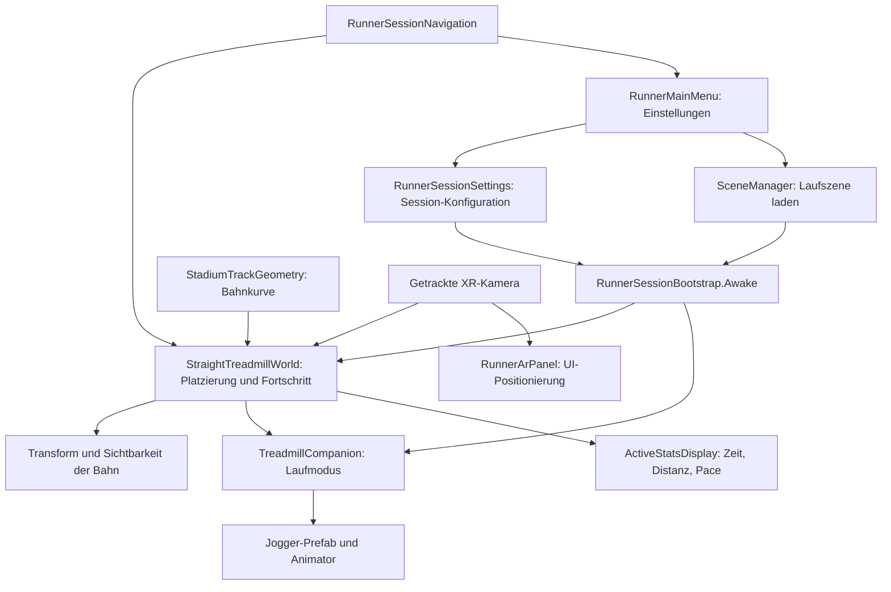
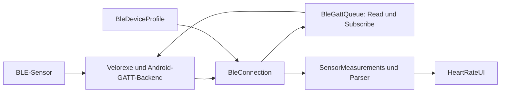

# MarkerML2 – AR-Lauftraining mit Magic Leap 2

MarkerML2 ist ein Unity-Prototyp für Lauftraining in Augmented Reality. Im aktuellen Hauptablauf steht der Nutzer auf einem Laufband. Die virtuelle 400-m-Bahn bewegt und dreht sich entsprechend der eingestellten Geschwindigkeit um ihn herum. Ein Avatar läuft als Begleiter neben ihm oder als Pacer voraus.

Das Projekt enthält außerdem einen getrennten Ablauf zur Platzierung eines Avatars über AprilTags und erkannte Bodenflächen sowie ein eigenes Paket für BLE-Sensordaten.

**Stand dieser Dokumentation:** aktueller Quellcode und Szenenkonfiguration vom 26.10.2026. Die Geschwindigkeit wird momentan simuliert; eine Verbindung zum echten Laufband ist noch nicht umgesetzt.

## Inhalt

- [Schnellstart](#schnellstart)
- [Technischer Aufbau](#technischer-aufbau)
- [Szenen und Laufablauf](#szenen-und-laufablauf)
- [Laufband-Simulation und 400-m-Bahn](#laufband-simulation-und-400-m-bahn)
- [Avatar und Laufmodi](#avatar-und-laufmodi)
- [Platzierung und Körpergröße](#platzierung-und-körpergröße)
- [UI und Eingabe](#ui-und-eingabe)
- [Marker- und Bodenflächen-Ablauf](#marker--und-bodenflächen-ablauf)
- [BLE-Sensorarchitektur](#ble-sensorarchitektur)
- [Projektstruktur](#projektstruktur)
- [Prüfung und Editor-Werkzeuge](#prüfung-und-editor-werkzeuge)
- [Erweiterungspunkte](#erweiterungspunkte)
- [Grenzen und Fehlersuche](#grenzen-und-fehlersuche)

## Schnellstart

1. Das Projekt mit **Unity 2022.3.62f3** öffnen.
2. Unity die Pakete und Assets importieren lassen. Die Magic-Leap-SDK-Abhängigkeit verwendet einen lokalen Pfad; auf einem anderen Rechner muss dieser angepasst werden, siehe unten.
3. `Assets/Scenes/RunnerMainMenu.unity` öffnen und **Play** starten.
4. Pace, Laufmodus, Körpergröße und Sichtbarkeit der Rennstrecke einstellen.
5. **Lauf starten** wählen. Die Anwendung lädt die Laufszene und platziert die Bahn automatisch nach einer kurzen Wartezeit auf die Kamerapose.
6. Über **Pause / Weiter** den Lauf unterbrechen beziehungsweise fortsetzen. **Menü** beendet die aktuelle Session und lädt das Hauptmenü.

Für den aktuellen Laufbandablauf muss kein Marker gescannt werden. Im Editor kann die simulierte Bewegung ohne physisches Laufband betrachtet werden. Eine normale Vorwärtsbewegung im Raum ist für diesen Test nicht nötig.

### Einstellungen im Hauptmenü

| Einstellung | Standard | Verhalten |
|---|---|---|
| Zielpace | 6:00 min/km | Schritte von 15 Sekunden; Bereich 3:00–20:00 min/km |
| Laufmodus | Neben mir | Begleiter mit festem Versatz oder Pacer voraus |
| Körpergröße | 184 cm | Schritte von 1 cm; Bereich 80–230 cm |
| Rennstrecke | Sichtbar | Bahn aus-/einblenden; Avatar und Simulation bleiben aktiv |

Die Einstellungen werden in einer statischen Klasse für die laufende Anwendung gehalten. Beim Zurückkehren ins Menü bleiben sie erhalten. Es gibt derzeit keine Speicherung über einen App-Neustart hinweg.

## Technischer Aufbau

### Laufzeit und Abhängigkeiten

| Baustein | Verwendung |
|---|---|
| Unity 2022.3.62f3 | Editor und Laufzeit |
| Magic Leap Unity SDK | Geräteintegration, Marker Understanding und weitere OpenXR-Funktionen |
| OpenXR 1.14.3 | XR-Laufzeit und Headtracking |
| Universal Render Pipeline 14.0.12 | Rendering |
| uGUI und TextMeshPro 3.0.7 | World-Space-Menüs und Anzeigen |
| XR Interaction Toolkit | UI-Raycasts und Interaktion |
| XR Hands / Input System | Handpose und Pinch-Eingabe |
| AR Foundation | Erkannte Bodenflächen im Markerablauf |
| `com.kaan.ble-sensors` | Eigenes eingebettetes BLE-Paket |
| Velorexe Android BLE | Android-Bluetooth-Anbindung des Sensorpakets |
| Unity MCP | Entwicklungswerkzeug zur Steuerung des Editors |

Direkte Paketangaben stehen in [`Packages/manifest.json`](Packages/manifest.json), tatsächlich aufgelöste Abhängigkeiten in [`Packages/packages-lock.json`](Packages/packages-lock.json). Unity MCP ist keine Quelle für Laufbandgeschwindigkeit oder Trainingsdaten.

**Portabilität:** Das Manifest referenziert das Magic-Leap-SDK derzeit als lokale `.tgz`-Datei unter `/Users/kaan/MagicLeap/tools/unity/v2.6.0/com.magicleap.unitysdk.tgz`. Auf einem anderen Rechner muss das SDK verfügbar gemacht und die Referenz entsprechend angepasst werden. Auch die Git-Abhängigkeiten müssen beim ersten Import erreichbar sein.

### Architektur des aktuellen Laufbandablaufs



Die Zuständigkeiten sind getrennt: Die Welt berechnet den Lauf, der Begleiter verwendet diesen Fortschritt, und das HUD zeigt die Werte an. Der Avatar berechnet im Laufbandmodus keine zweite eigene Laufdistanz.

## Szenen und Laufablauf

| Szene | Aufgabe |
|---|---|
| [`RunnerMainMenu.unity`](Assets/Scenes/RunnerMainMenu.unity) | Einstieg, Einstellungen und Start einer Session |
| [`TreadmillStraightTest.unity`](Assets/Scenes/TreadmillStraightTest.unity) | Aktuelle Laufband-Szene mit 400-m-Oval, Begleiter und Live-HUD; der historische Name enthält weiterhin „Straight“ |
| [`SampleScene.unity`](Assets/Scenes/SampleScene.unity) | Vorhandener Marker-/Bodenflächen-Ablauf und zugehörige Oberflächen |
| [`UI.unity`](Assets/Scenes/UI.unity) | Ältere zusätzliche Szene mit fehlender Canvas-Prefab-Referenz; gehört nicht zum aktuellen Startablauf |

In den Build Settings sind Hauptmenü und Laufband-Szene in dieser Reihenfolge aktiviert. `SampleScene` ist dort eingetragen, aber deaktiviert.

### Übergabe vom Menü zur Session

1. [`RunnerMainMenu`](Assets/Scripts/StadionTracking/RunnerMainMenu.cs) verarbeitet Buttons und aktualisiert die sichtbaren Einstellungswerte.
2. [`RunnerSessionSettings`](Assets/Scripts/StadionTracking/RunnerSessionSettings.cs) hält Pace in Sekunden pro Kilometer, Körpergröße in Zentimetern, Laufmodus, Streckensichtbarkeit und ein `Pending`-Flag.
3. Beim Start wird `Pending` gesetzt und die Szene `TreadmillStraightTest` geladen.
4. [`RunnerSessionBootstrap`](Assets/Scripts/StadionTracking/RunnerSessionBootstrap.cs) übernimmt in `Awake` die Einstellungen in Welt und Begleiter und löscht das Flag. Die automatische Platzierung der Welt startet anschließend in `Start`.
5. Sobald die Platzierung bestätigt ist, bewegt sich die Welt und der Begleiter wird sichtbar.

Wird die Laufszene direkt im Editor geöffnet, gelten ihre Inspector-Werte anstelle einer neuen Menüübergabe. In der aktuellen Szene sind unter anderem 10 km/h, 184 cm Körpergröße und das Oval aktiviert.

## Laufband-Simulation und 400-m-Bahn

### Bewegung der Welt

[`StraightTreadmillWorld`](Assets/Scripts/StadionTracking/StraightTreadmillWorld.cs) ist die zentrale Instanz für Geschwindigkeit, zurückgelegte Strecke, Platzierung und Umgebungsbewegung.

- Die XR-Kamera bleibt unter Kontrolle des Headtrackings.
- Die Umgebung wird verschoben und in Kurven gedreht.
- Der aktuelle virtuelle Laufpunkt wird dabei auf der kalibrierten Laufbandposition gehalten.
- Die Tangente der Bahn bleibt zur anfänglichen Laufrichtung ausgerichtet. Das Umsehen des Nutzers verändert diese festgelegte Laufrichtung nicht fortlaufend.

Bei geraden Teststrecken werden wiederholbare Bahnkacheln zyklisch verschoben. Im aktuellen Ovalmodus wird stattdessen eine Position samt Laufrichtung auf der Bahnkurve ausgewertet und die gesamte Welt passend transformiert.

### Einheiten und Berechnung

Eine Unity-Einheit entspricht einem Meter. Intern ist die eingestellte Geschwindigkeit in km/h gespeichert.

```text
m/s = km/h / 3,6
km/h = 3600 / Pace in Sekunden pro Kilometer
zurückgelegte Meter pro Frame = m/s × vergangene Sekunden
```

Beispiele: 6:00 min/km entsprechen 10 km/h; 7:30 min/km entsprechen 8 km/h.

Die Simulation läuft in `Update` mit `Time.deltaTime`. Geschwindigkeit 0 pausiert den Fortschritt, ohne die bereits zurückgelegte Distanz zu löschen. Die Pause-Funktion setzt die Geschwindigkeit auf 0 und stellt sie beim Fortsetzen wieder her; sie verwendet keine globale Pause über `Time.timeScale`.

### Bahngeometrie

[`StadiumTrackGeometry`](Assets/Scripts/StadionTracking/StadiumTrackGeometry.cs) beschreibt das Oval mathematisch:

- Zwei Geraden mit je 84,39 m.
- Innerer Radius 36,50 m.
- Acht Bahnen mit je 1,22 m Breite.
- Messlinie von Bahn 1 mit 0,30 m Abstand zum Innenrand; bei äußeren Bahnen 0,20 m zur jeweiligen inneren Begrenzung.

Die Klasse bietet `Length`, `Evaluate`, `Project` und `DetectLane`: Bahnlänge berechnen, Streckenmeter in Position und Tangente umwandeln, Position auf den Laufweg projizieren und eine Bahn zuordnen.

Die geometrische Messlinie von Bahn 1 ergibt mit diesen gerundeten Abmessungen ungefähr 400,0012 m. Der Laufbandmodus normalisiert seinen virtuellen Rundenfortschritt auf exakt 400 m. Außenbahnen sind geometrisch länger; die zugehörige Auswertung ist insbesondere im Marker-/Avatarablauf relevant.

Die sichtbare Bahn wird mit [`TreadmillOvalSetup`](Assets/Editor/TreadmillOvalSetup.cs) als Mesh erzeugt und in der Szene gespeichert. Für den normalen Start ist keine erneute Mesh-Erzeugung erforderlich.

### Rennstrecke ein- und ausblenden

Der Menüschalter setzt `RunnerSessionSettings.ShowTrack`; beim Szenenwechsel übernimmt die Welt diesen Wert in `ShowTrack`.

Ausgeblendet werden die von der Welt verwalteten statischen MeshRenderer. Die Simulation und das Weltobjekt bleiben aktiv. Deshalb laufen Distanz, Kurvenverlauf, Avatar und HUD weiter. Auch eine ausgeblendete Strecke benötigt weiterhin eine gültige Platzierung, damit der Avatar auf der richtigen Höhe erscheint.

## Avatar und Laufmodi

[`TreadmillCompanion`](Assets/Scripts/StadionTracking/TreadmillCompanion.cs) verwendet das [`Jogger.prefab`](Assets/Jogger.prefab). Der Avatar wird erst erzeugt, wenn die Welt platziert und die Höhe bestätigt ist.

| Modus | Position und Bewegung |
|---|---|
| `SideBySide` / Neben mir | Fester, im Inspector konfigurierbarer Versatz relativ zur kalibrierten Laufbandposition und Laufrichtung |
| `Pacer` | Standardmäßig 3 m entlang des tatsächlichen Bahnverlaufs voraus; Position und Ausrichtung folgen auch den Kurven |

**Aktuelle Szenenkonfiguration:** `sideOffset` ist in `TreadmillStraightTest` auf `(2.22, 0, 5)` gesetzt. Das bedeutet 2,22 m seitlich und 5 m voraus. Der Name „Neben mir“ garantiert daher keinen reinen Seitenversatz. Für eine Position direkt daneben kann der Z-Wert im Inspector auf 0 gesetzt werden. Der Code-Standard ist `(1.22, 0, 0)`; gespeicherte Inspector-Werte haben Vorrang.

Der Avatar erhält dieselbe Geschwindigkeit wie die Welt. [`LocomotionTiming`](Assets/Scripts/StadionTracking/LocomotionTiming.cs) bestimmt daraus Gangart-Mischung und Abspielgeschwindigkeit. Die vorhandenen Animationsclips werden zur Ermittlung passender Bewegungsgeschwindigkeiten herangezogen.

Verwendete Animator-Parameter:

- `isRunning`: Laufen beziehungsweise Stehen.
- `speed`: Mischung der Bewegungsanimationen.
- `locomotionRate`: Abspielgeschwindigkeit, sofern der Controller den Parameter besitzt.

Root Motion ist deaktiviert, damit die Animation den Avatar nicht zusätzlich verschiebt. Der Begleiter korrigiert außerdem die Modellposition anhand des tiefsten Punkts, damit die Füße zur berechneten Bodenhöhe passen.

## Platzierung und Körpergröße

Der Laufbandmodus verwendet standardmäßig eine automatische Schätzung der Augenhöhe:

```text
Augenhöhe = Körpergröße − 12 cm
Bahnoberfläche Y = getrackte Augenhöhe Y − geschätzte Augenhöhe
```

Bei 184 cm Körpergröße werden somit 172 cm Augenhöhe angenommen. Vor der Platzierung wartet der Code ungefähr 0,5 Sekunden auf eine verfügbare Kamerapose. Auf dem Gerät wird zusätzlich das Headtracking berücksichtigt.

Dies ist keine automatische Vermessung der Körpergröße oder der Laufbandoberfläche. Die Höhe eines erhöhten Laufbands und individuelle Unterschiede können eine Korrektur erfordern.

[`TreadmillHeightSetup`](Assets/Scripts/StadionTracking/TreadmillHeightSetup.cs) enthält weiterhin ein optionales manuelles Kalibrierungsmenü mit Zahleneingabe, Vorschau, ±2-cm-Korrektur und Anforderung einer OpenXR-Bodenreferenz. Im aktuellen automatischen Ablauf wird dieses Menü nicht vorgeschaltet. Die Welt übernimmt die automatische Platzierung unabhängig davon, ob dieses optionale UI-Objekt aktiviert ist.

Eine OpenXR-Bodenreferenz ist außerdem nicht automatisch die Oberfläche eines erhöhten Laufbands. Die entsprechenden Methoden behandeln diese Referenz als alternative Kalibrierungsquelle, nicht als garantierte Erkennung des Laufbandgurts.

## UI und Eingabe

### Zuständigkeiten

| Skript | Verantwortung |
|---|---|
| [`ActiveStatsDisplay`](Assets/Scripts/StadionTracking/ActiveStatsDisplay.cs) | Zeit, Distanz und Pace aus Laufbandwelt oder gebundenem Marker-Runner anzeigen |
| [`RunnerSessionNavigation`](Assets/Scripts/StadionTracking/RunnerSessionNavigation.cs) | Pause/Weiter sowie Rückkehr ins Menü |
| [`RunnerArPanel`](Assets/Scripts/StadionTracking/RunnerArPanel.cs) | Kamerabezogene World-Space-Platzierung, Skalierung und Priorität der Panels |
| [`RunnerUiTheme`](Assets/Scripts/StadionTracking/RunnerUiTheme.cs) | Gemeinsame Farben, Schriftgrößen und UI-Erzeugung |
| [`RunnerGlassGraphic`](Assets/Scripts/StadionTracking/RunnerGlassGraphic.cs) | Geometrie und Materialdaten der gerundeten Glasflächen und flachen Buttons |
| [`RunnerGlass.shader`](Assets/Scripts/StadionTracking/Resources/RunnerGlass.shader) | Glasverlauf, Tönung, Kontur, Lichtsaum und angenäherter Schatten |
| [`UIScript`](Assets/UIScript.cs) | Bestehende Steuerung eines gebundenen Marker-Runners über Tempo-/Zielzeit-Slider |
| [`RunnerMapMarker`](Assets/Scripts/StadionTracking/RunnerMapMarker.cs) / [`SimpleTrackMap`](Assets/Scripts/StadionTracking/SimpleTrackMap.cs) | Kartenprojektion und Positionsmarker für den Marker-Runner |

Das Hauptmenü sitzt horizontal und vertikal mittig im Sichtfeld. Das Lauf-HUD sitzt weiter innen links oberhalb der Blickmitte; sein Standardmittelpunkt liegt bei Viewport `(0.30, 0.68)`, wobei Y von unten gemessen wird. `Running Hud Centre` am `RunnerArPanel` ist dafür die maßgebliche Einstellung. Ältere Positionsfelder am `ActiveStatsDisplay` steuern die aktuelle gemeinsame Panel-Platzierung nicht mehr.

`RunnerArPanel` zeigt von mehreren aktiven Panels das mit der höchsten Priorität. Dadurch liegen nicht mehrere Hauptflächen gleichzeitig übereinander. Diese Auswahl ist eine Sichtbarkeitssteuerung der Canvases und kein zusätzlicher Szenen- oder Session-Manager.

### Gestaltung und optische Grenzen

Die Gestaltung folgt dem bereitgestellten Runner-Stats-AR-Styleguide, ergänzt um die gewünschten Positionierungen. Das Referenzlayout beträgt 1280 × 720 mit 300 Einheiten Panelbreite; es wird an das Kamerasichtfeld angepasst.

- Zeit in Cyan `#67E8F9`.
- Andere Werte weiß, Labels und Einheiten `#E3DEF7`.
- Fortschritt beziehungsweise Kartenmarker `#D9F99D`.
- Warnakzente `#FF8A7A`.
- Timer 56, Hauptwerte 28, Labels und Einheiten mindestens 13 im Referenzlayout.
- Drei Livewerte im Lauf-HUD: Zeit, Distanz und Pace.

Eine optisch durchsichtige Magic Leap 2 zeigt die reale Welt direkt. Der verwendete Canvas-Shader kann diesen realen Hintergrund nicht weichzeichnen oder dessen Sättigung verändern. Die Umsetzung rendert die Glasoptik ohne echtes Blur der Umgebung. Details und Abweichungen stehen in [`Assets/UI/STYLE_GUIDE_IMPLEMENTATION.md`](Assets/UI/STYLE_GUIDE_IMPLEMENTATION.md).

### Handinteraktion

[`Gestures`](Assets/Gestures.cs) verbindet die Hand-Aim-Pose und Pinch-Aktionen mit dem XR-Ray-Interactor. Eine eigene Button-Aktion mit Press-Schwelle 0,7 verhindert, dass bereits ein schwacher Pinch als UI-Klick zählt. Slider können während des Pinchens entlang ihrer lokalen X-Achse gezogen werden.

Die Oberflächen verwenden World-Space-Canvases, `XRUIInputModule` und `TrackedDeviceGraphicRaycaster`. Im vorhandenen EventSystem ist auch Maus-Eingabe für Editor-Interaktion aktiviert.

## Marker- und Bodenflächen-Ablauf

Dieser Ablauf ist vom aktuellen Laufbandstart getrennt. Hier wird ein Avatar räumlich platziert und bewegt sich entlang einer verankerten virtuellen Route, während beim Laufbandmodus die Umgebung am Nutzer vorbeiläuft.

[`MarkerAndAnchorTracker`](Assets/MarkerAndAnchorTracker.cs) übernimmt:

1. Initialisierung des Magic-Leap-AprilTag-Detektors; Standard ist Dictionary 36H11 mit konfigurierbarer Markergröße.
2. Verwaltung erkannter Marker und ihrer Posen im XR-Sessionraum.
3. Abfrage und Auswahl geeigneter Bodenflächen über `ARPlaneManager` und die Magic-Leap-Plane-Funktionen.
4. Platzierung des Avatars auf einer bestätigten Fläche vor dem Nutzer, bei Bedarf mit begrenzter Positionskorrektur zur Bodenfläche.
5. Glättung von Bodenhöhe und Neigung sowie Ausrichtung der Füße auf der Fläche.
6. Erzeugung einer optionalen Stadionvorschau und Bindung von Steuerungs-UI und Live-HUD an den erzeugten Runner.

[`StadiumTrackPreview`](Assets/Scripts/StadionTracking/StadiumTrackPreview.cs) verbindet Bahngeometrie, Darstellung der Route, Fortschritt und Avatarbewegung. [`StadiumPreviewSettings`](Assets/Scripts/StadionTracking/StadiumPreviewSettings.cs) definiert unter anderem Referenzbahn, Referenzmeter, Richtung und Platzierungsart:

- `AvatarSpawnPreview`: Der Referenzpunkt der virtuellen Bahn liegt am Avatar-Spawnpunkt.
- `KnownMarkerPosition`: Die Route wird über eine bekannte Markerposition und konfigurierte Abstände ausgerichtet.

[`StadiumRunProgress`](Assets/Scripts/StadionTracking/StadiumRunProgress.cs) zählt Strecke und Runden. [`StadiumPacing`](Assets/Scripts/StadionTracking/StadiumPacing.cs) berechnet bei Zielrundenzeit die Geschwindigkeit aus der tatsächlichen Länge der gewählten Bahn. `UIScript` bietet dafür `ManualSpeed` und `TargetLapTime` an.

Diese beiden älteren Pacing-Modi sind etwas anderes als die Begleiter-Modi `SideBySide` und `Pacer` im Hauptmenü.

Trotz des Namens `MarkerAndAnchorTracker` enthält dieser Ablauf keine implementierte dauerhafte Speicherung oder Wiederherstellung von Spatial Anchors über App-Neustarts. Markerzustände und räumliche Zuordnungen werden in der laufenden Session verwaltet.

## BLE-Sensorarchitektur

Die Sensorintegration ist als **Embedded UPM Package** unter [`Packages/com.kaan.ble-sensors`](Packages/com.kaan.ble-sensors) abgelegt. Sie hat eine eigene Runtime- und Editor-Assembly und ist von der Laufband-Simulation getrennt.



| Baustein | Aufgabe |
|---|---|
| `BleDeviceProfile` | ScriptableObject mit Gerätefilter, Service-/Characteristic-UUIDs, Formaten und Kanaloptionen |
| `BleConnection` | Berechtigungen, Scan, Geräteauswahl, Verbindung, GATT-Erkennung und Ereignisse |
| `BleGattQueue` | Serielle Ausführung der GATT-Aufträge |
| `AndroidBleGattBackend` | Verbindung zum nativen Android-Companion-JAR |
| `SensorMeasurements` | Kanalzuordnung, Decodierung, Aktualität und aufbereitete Messwerte |
| `HeartRateParser` / `CosinussParsers` | Auswertung der unterstützten Datenformate |
| `HeartRateUI` | Scan-/Verbindungsbuttons, Geräteliste, Status und Vitalwerte |

Unterstützte Kanalformate umfassen Herzfrequenz, Temperatur, Pulsoximetrie, Batterie, Text, cosinuss-Status und rohe Hexdaten. Welche Daten ein Gerät tatsächlich anbietet, hängt von Profil, gefundenen Characteristics und dem Geräteprotokoll ab. Unbekannte Protokolle benötigen einen passenden Decoder.

Die UI und ein bearbeitbares cosinuss-Profil liegen unter `Assets/HeartRateBLE`. Das Paket enthält außerdem die Kompatibilitätsklassen `HeartRateBLE` und `CosinussMeasurements`.

**Abgrenzung:** BLE-Vitalwerte steuern derzeit weder Pace noch Laufband. Eine Samsung-Gear-S3-/Tizen-App beziehungsweise eine Unity-Gegenstelle für ein eigenes Uhrenprotokoll ist in diesem Projektstand nicht implementiert. Der aktuelle Menüablauf bietet auch noch keinen separaten Sensor-Konfigurationsschritt.

Ein echter BLE-Scan ist im Unity-Editor nicht verfügbar; der Code begrenzt ihn auf Android außerhalb des Editors. Auf Android werden abhängig von der API-Version Standort- oder Bluetooth-Berechtigungen angefordert. Das vorhandene Manifest liegt unter [`Assets/Plugins/Android/AndroidManifest.xml`](Assets/Plugins/Android/AndroidManifest.xml) und enthält auch die XR-Berechtigungen.

Weitere Paketdetails, Installation und bekannte native Einschränkungen: [`Packages/com.kaan.ble-sensors/README.md`](Packages/com.kaan.ble-sensors/README.md). Das native Companion-JAR hängt von Interna der dokumentierten Velorexe-Revision ab; ein Plugin-Update erfordert eine erneute Prüfung.

## Projektstruktur

```text
Assets/
  Scenes/                         Hauptmenü, Laufband- und weitere Szenen
  Scripts/StadionTracking/         Simulation, Geometrie, Avatar, UI und Sessionlogik
    Resources/                    Laufzeit-Shader, darunter RunnerGlass.shader
  Editor/                         Szenenaufbau, Prüfungen und vorhandener Build-Helfer
  Resources/RunnerUI/              Glasmaterial und TMP-Schriftasset
  HeartRateBLE/                    Sensor-Canvas und Geräteprofil
  Materials/RunnerStatsCanvas.prefab
  Jogger.prefab                    Begleiter-Modell mit Animator
  MarkerAndAnchorTracker.cs        Marker-/Bodenflächen-Ablauf
  Gestures.cs                      Hand-Ray und Pinch
  UIScript.cs                     Ältere Runner-Steuerung
  Plugins/Android/                 Android-Manifest
  UI/STYLE_GUIDE_IMPLEMENTATION.md Gestaltung und technische Grenzen
  Samples/                        Importierte Paketbeispiele
Packages/
  com.kaan.ble-sensors/            Eigenes Embedded Package
  manifest.json                   Direkte Paketabhängigkeiten
  packages-lock.json              Aufgelöste Paketversionen
ProjectSettings/                  Unity-, XR-, Plattform- und Szenenkonfiguration
Tests/StadionTracking/             Eigenständige C#-Prüfprogramme
Tools/generate_simple_track.py     Erzeugung der schematischen Bahnkarte
BLE-Delivery/                     Paketarchiv und Migrationsdaten des BLE-Pakets
```

`Library`, `Temp`, `Logs`, `Build` und ähnliche Ordner enthalten lokale beziehungsweise erzeugte Daten. Sie sind keine maßgeblichen Projektquellen und werden über `.gitignore` ausgeschlossen.

## Prüfung und Editor-Werkzeuge

### Normaler manueller Funktionstest

1. Hauptmenü öffnen und Play starten.
2. Pace, Körpergröße und beide Laufmodi ausprobieren.
3. Mit sichtbarer und ausgeblendeter Rennstrecke starten.
4. Platzierung, Avatarposition und zunehmende Zeit/Distanz beobachten.
5. Pause drücken: Welt, Distanzfortschritt und Laufanimation sollen anhalten.
6. Weiter drücken: Der Lauf soll an derselben Distanz fortgesetzt werden.
7. Zum Menü zurückkehren: Die Einstellungen sollen erhalten bleiben; ein neuer Start beginnt eine neue Session.

### Vorhandene Menüprüfungen

Unter **Tools → Runner UI → Checks** stehen unter anderem:

- **Check menu and start Pacer session:** Im Play-Modus aus dem Hauptmenü starten. Prüft Eingabegrenzen, Modusbuttons, Streckenschalter und Paneldarstellung; lädt anschließend eine Testsession mit **6:15 min/km, 183 cm, Pacer und ausgeblendeter Strecke**.
- **Check track and pause:** Anschließend in der platzierten Laufszene ausführen. Prüft Einstellungsübernahme, Avatar, Aus-/Einblenden ohne Distanzreset, Pause/Weiter und HUD-Grenzen.
- **Return to menu:** Rückkehr zum Menü im Play-Modus.
- **Preview sensors / Preview runner controls:** Erstellt im Edit-Modus eine temporäre Vorschau. Für eine laufende Game-View-Darstellung kann anschließend Play verwendet werden.
- **Reload saved menu (discard preview):** Verwirft die temporäre Vorschau und lädt die gespeicherte Hauptmenü-Szene.

Unter **Tools → Treadmill** liegen zusätzliche Prüfungen für Ovalbewegung, Platzierung, Begleiter und beide Laufmodi. Die Voraussetzungen unterscheiden sich je nach Prüfung; die betreffenden Editor-Skripte enthalten die Details.

Die Programme `Tests/StadionTracking/GeometryChecks.cs` und `LocomotionChecks.cs` besitzen jeweils einen eigenen `Main`-Einstieg für die reine C#-Logik. Sie sind keine automatisch entdeckten Unity-Test-Runner-Tests und benötigen eine passende C#-Kompilierung mit ihren Quelldatei-Abhängigkeiten.

### Aufbauwerkzeuge und Build-Helfer

`StraightTreadmillSetup`, `TreadmillOvalSetup`, `TreadmillCompanionSetup` und `RunnerUiGuideSetup` erzeugen oder verändern Szenen, Meshes und UI-Assets. Sie sind Entwicklungswerkzeuge und werden für den normalen App-Start nicht ausgeführt. Insbesondere **Apply guide to project and create main menu** gestaltet mehrere Projektassets neu und erstellt die Menüszene erneut; es ist kein notwendiger Startschritt für das vorhandene Projekt.

`TreadmillDeviceBuild` enthält einen älteren manuellen APK-Helfer. Er baut ausdrücklich nur `TreadmillStraightTest` und umgeht damit das Hauptmenü. Für einen späteren vollständigen App-Build wäre die aktivierte Szenenliste aus den Build Settings maßgeblich.

Die zuletzt vorgenommenen UI-, Modus- und Sichtbarkeitsänderungen wurden im Editor geprüft. Das ist kein Nachweis für Headtracking, Pinch-Ergonomie, reale Höhenpassung oder Bluetooth-Funktion auf der Brille. Für die Erstellung dieser README wurden keine Builds, Geräteinstallationen oder neuen Laufzeittests ausgeführt.

## Erweiterungspunkte

### Echtes Laufband anbinden

Die zentrale Schnittstelle ist `StraightTreadmillWorld.SetSpeedKmh(float)` beziehungsweise die Eigenschaft `SpeedKmh`. Ein zukünftiger Adapter kann Messwerte aus dem Laufbandprotokoll entgegennehmen, in km/h umrechnen und diese Schnittstelle auf dem Unity-Hauptthread aktualisieren.

Dabei muss festgelegt werden, welche Quelle die Geschwindigkeit kontrolliert: simulierte Menüpace oder reale Laufbandmessung. Ebenso braucht es ein definiertes Verhalten bei Verbindungsverlust und beim Zusammenspiel mit Pause/Weiter. Der aktuelle Code enthält dafür noch keinen Laufbandtransport oder vollständigen Verbindungszustandsautomaten.

### Weiteren BLE-Sensor ergänzen

Ein neues `BleDeviceProfile` mit Filter und UUIDs erstellen und vorhandene Formate zuweisen. Für ein unbekanntes Datenformat zusätzlich den Decoder ergänzen. Die Verbindung und UI können anschließend über die bestehenden Ereignisse weiterverwendet werden. Eine beliebige Uhr wird allein durch ein neues Profil nicht automatisch kompatibel.

### Darstellung und Avatar ändern

- Gemeinsame Farben und Typografie: `RunnerUiTheme`.
- HUD-Position: `RunnerArPanel.runningHudCentre` im Inspector.
- Menüposition: Zentrierung des Panels mit `RunnerMainMenu`.
- Abstand und Position des Begleiters: `TreadmillCompanion.sideOffset` und `pacerLeadMetres`.
- Avatarmodell: referenziertes Prefab und Animator; Root Motion bleibt für die aktuelle Simulationsarchitektur deaktiviert.
- Bahnform: `StadiumTrackGeometry` sowie die Mesh-Erzeugung in `TreadmillOvalSetup`; Messlinie, Darstellung und Fortschrittsnormalisierung müssen zusammenpassen.

## Grenzen und Fehlersuche

| Beobachtung | Relevante Stelle / Erklärung |
|---|---|
| Paketimport schlägt auf einem anderen Rechner fehl | Lokalen Magic-Leap-SDK-Pfad im Manifest prüfen |
| Bahn erscheint nicht | Streckenschalter, `PlacementReady`, Höhenbestätigung, Kamerareferenz und `[Treadmill]`-Logs prüfen |
| Avatar fehlt trotz ausgeblendeter Bahn | Ausblenden der Bahn ersetzt die Platzierung nicht; Weltreferenz und Avatar-Prefab am Begleiter prüfen |
| Bahn ist auf Kopf- statt Fußhöhe | Körpergröße, geschätzte Augenhöhe, Tracking-Ursprung und gegebenenfalls Laufbandhöhe prüfen |
| „Neben mir“ steht seitlich und voraus | Den gespeicherten `sideOffset` der Szene prüfen; Z ist aktuell 5 m |
| HUD-Position ändert sich trotz manuell verschobenem Canvas | `RunnerArPanel` berechnet die Position relativ zur Kamera erneut |
| Nur ein UI-Panel ist sichtbar | Prioritätsauswahl durch `RunnerArPanel` prüfen |
| Geschwindigkeit passt nicht zur Erwartung | Pace in min/km, Sekunden/km, km/h und m/s unterscheiden |
| BLE-Scan liefert im Editor keine Geräte | Reale Funkfunktion ist dort nicht implementiert |
| Sensormesswert bleibt leer | Gerätefilter, entdeckte UUIDs, Read/Subscribe, Datenformat und Aktualität prüfen |
| Fehler beim Öffnen von `UI.unity` | Die ältere Szene referenziert ein fehlendes Canvas-Prefab; sie wird für den Hauptablauf nicht benötigt |

Weitere offene Funktionen sind eine dauerhafte Trainingshistorie, ein implementiertes Session-Ergebnisfenster, automatische Körpergrößen-/Laufbandhöhenerkennung, eine echte Laufbandanbindung und ein eigenes Gear-S3-/Tizen-Protokoll. Die angezeigte Distanz wird momentan aus der eingestellten Geschwindigkeit integriert und nicht am Laufband gemessen.
